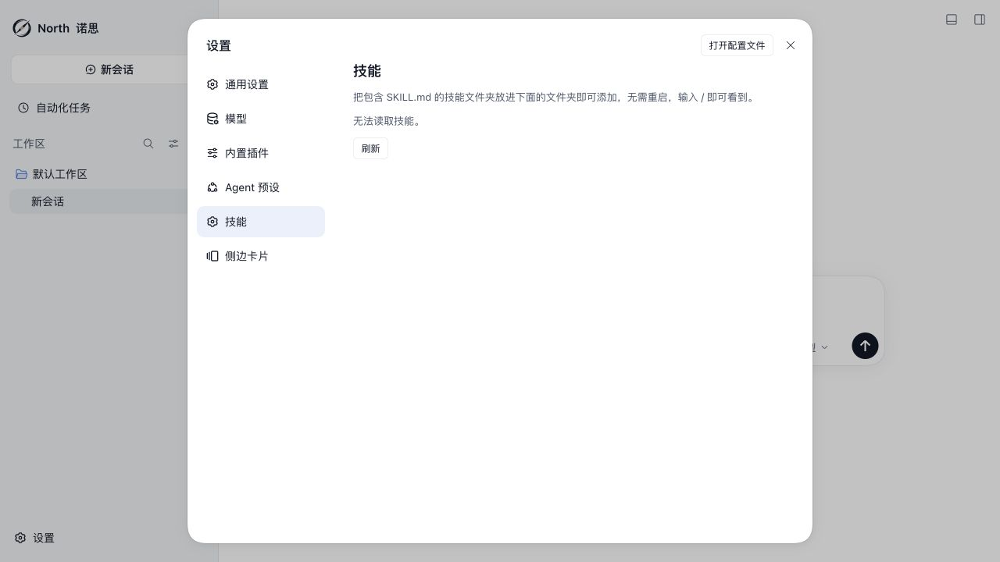
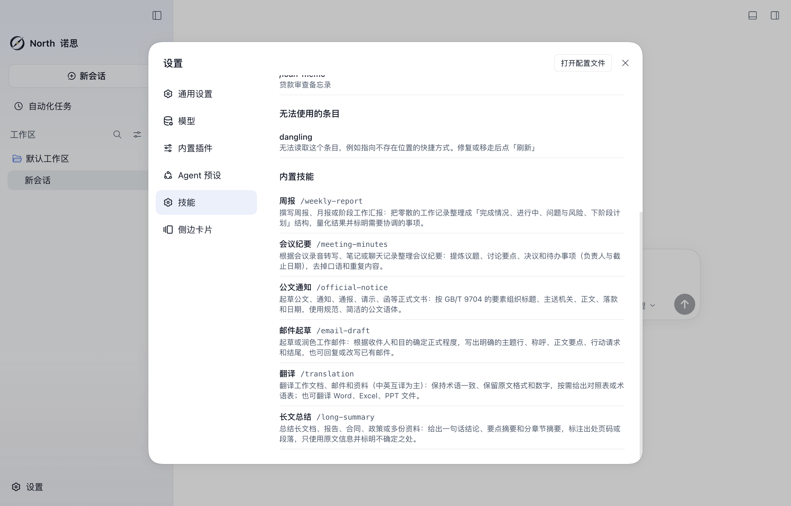
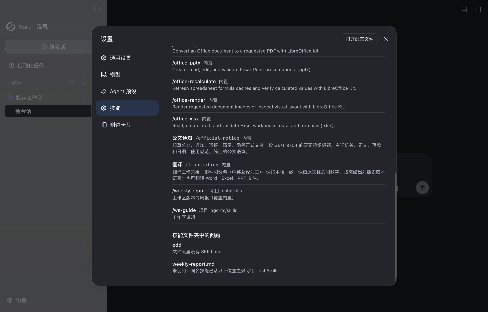

# North 代码、视觉与功能审计（2026-10-23）

审计日期：2026-10-23（北京时间）。本文是供 Claude 修复时使用的审计交接记录，记录当时工作区的观察结果，不代表修复完成或发布验收通过。审计时已有大量未提交改动，本轮未修改业务代码，也未提交、推送或发布。

## 结论与范围

发现两项 P2 功能问题：单个异常文件使技能页整体不可用；技能页把不允许用户调用的技能显示成斜杠命令。浅深色界面基础表现正常，但 Windows、真实模型和 Office 文件生成尚未验收。

重点检查 North 定制包、技能目录管理、发行版配置、主题与发送按钮，以及相关测试和桌面启动环境逻辑；没有穷尽上游框架全部代码。动态检查使用 macOS 上的隔离 Web 实例和临时技能目录，没有发送真实模型请求，也没有修改用户的实际技能库。

## F1：异常条目导致技能页整体不可用

**严重程度：P2。状态：已在完整 North Web 组合中复现，待修复。**

代码位置：[folder.ts](packages/north/skill-writing/src/folder.ts) 的 `readEntry()`、`readNorthSkills()`（审计时第 55、85 行），以及 [SkillsSection.tsx](packages/north/skill-writing/src/client/SkillsSection.tsx) 的失败分支（第 80–95 行）。

复现步骤：

1. 启动隔离的 North Web 组合，让 `DSH_HOME` 指向临时目录；不要使用真实用户目录。
2. 打开“设置 → 技能”，确认六项内置技能、技能目录路径和“打开文件夹”正常显示。
3. 在该临时技能目录中加入一个指向不存在目标的符号链接。
4. 刷新技能页，或关闭设置后重新进入技能页。

实际结果：整个页面只显示“无法读取技能”和“刷新”；正常技能、内置技能、目录路径和“打开文件夹”入口全部消失。删除或修复异常条目前，重复刷新无法帮助用户恢复。这里只在 macOS 上复现了符号链接场景，未声称已在 Windows 上复现。

根因：`stat(path)` 的拒绝没有在条目级处理；`Promise.all` 将单个条目异常传播成整个目录请求失败。客户端只保留 `loading / failed / ready` 状态，失败后不保留之前成功读取的数据。现有 `route.spec.ts` 还明确把某些不可读条目断言为 HTTP 500，未覆盖局部失败时正常内容仍可使用的行为。

建议修复：将条目级失败归入可定位的异常条目，保留正常条目和内置技能；目录整体不可读时提供明确的恢复提示。刷新失败时尽可能保留已有内容、目录路径和打开目录入口，不把未知条目误报为正常或空目录。

验收标准：

- 正常技能与失效符号链接并存时，正常技能仍显示，异常条目能被定位。
- 首次读取失败和刷新失败分别有测试；刷新失败不清空已显示的有效内容。
- 根目录整体不可读与单条目不可读采用不同处理，错误不被静默吞掉。
- 修复或移走异常条目后，刷新即可恢复，不要求重启应用。



## F2：技能展示与用户调用权限不一致

**严重程度：P2。状态：已核对测试技能的设置页展示和实际调用目录过滤逻辑，待修复。**

代码位置：[folder.ts](packages/north/skill-writing/src/folder.ts) 的 `readSkillSummary()`（第 41–44 行）、[shared.ts](packages/north/skill-writing/src/shared.ts) 的 `NorthSkillSummary`、[SkillsSection.tsx](packages/north/skill-writing/src/client/SkillsSection.tsx) 的 `SkillList()`（第 34–40 行）。实际调用目录的对照位置为 [skill-catalog.ts](packages/api/session-controller/src/skill-catalog.ts) 第 78 行的 `filter(isUserInvocable)`。

复现输入：在隔离用户技能目录中添加带合法 `name`、`description`，并设置 `user-invocable: false` 的技能文件，然后刷新技能页。

实际结果：技能页仍把该条目显示成 `/audit-hidden`，上方统一说明“输入 / 即可看到”；实际斜杠技能目录会过滤禁止用户调用的技能。设置页将目录清单与可手动调用清单混为一谈，用户无法判断为什么添加成功却不能按页面提示调用。

根因：服务端虽然复用了 frontmatter 解析器，却在摘要中丢弃了 `invocation`，客户端再无条件为每个技能名称添加 `/` 前缀。

建议修复：保留必要调用属性，并区分可手动调用、仅模型调用等状态；不可手动调用的条目不应表现为可执行斜杠命令。同步调整说明文案和共享响应类型，不必扩大为技能编辑器。

验收标准：

- 默认技能仍能按正常方式展示和调用。
- `user-invocable: false` 的技能不被展示为可手动调用命令。
- 只允许用户调用、只允许模型调用和两者均关闭的配置有清晰且准确的展示。
- 设置页与真实 `skills/list` 的权限语义一致，相关 UI 文案继续通过国际化检查。

## 视觉与功能设计观察

查看了浅色首屏、深色设置、800px 窄窗口，以及完整 North 组合的技能页；在这些已查看场景中，没有发现明显乱码、遮挡或主体溢出。主题测试也检查了浅深色 token 和发送按钮的默认、悬停状态，这不等于所有控件都完成了可访问性验收。

技能页的英文命令名和长描述占据主要信息层级。面向普通办公用户，可以优先展示“周报、会议纪要”等中文名称，英文调用名作为辅助信息。这是设计建议，不是已证实的功能缺陷；不要在修复 F1/F2 时顺带扩大改版范围。

现有 [north-theme.overlay.yml](apps/web/tests/north-theme.overlay.yml) 只挂载品牌插件，没有加载完整 North 配置、技能页及第三方侧栏。因此主题测试通过不能替代发行版整体回归。本次另行启动了完整 North Web 配置，确认办公助手默认项、技能设置入口及插件主导航隐藏，但未覆盖第三方侧栏所有交互。

## 已执行验证

以下结果来自本次审计，不应在代码修改后直接沿用为修复通过证据。

| 检查 | 结果 |
|---|---|
| `pnpm exec vitest run packages/north packages/skill/skill-filesystem/tests/skill-filesystem.spec.ts` | 8 个文件、63 项测试通过 |
| `DSH_SNAPSHOT=replay NORTH_THEME_REVIEW_DIR=/tmp/north-audit-20261023 pnpm exec vitest run --config vitest.web.config.ts apps/web/tests/north-theme.e2e.ts` | 1 项浏览器测试通过；检查了输出截图 |
| `pnpm run verify-client-ui-i18n` | 通过，检查 1069 个 Client UI 源文件 |
| `git diff --check`、`git diff --cached --check` | 通过 |
| 完整 North Web 组合人工检查 | 首次启动说明、默认办公助手、技能页和异常复现完成；未发送模型请求 |

完整组合的审计启动使用下列命令；这是 Web 检查，不包含 Desktop 专有 Office 运行时。复现时应改用新的临时目录，避免复用之前的测试状态。

```sh
DSH_HOME=/tmp/north-audit-home-20261023 \
DSH_AGENTS_HOME=/tmp/north-audit-agents-20261023 \
DSH_TELEMETRY_DISABLED=1 NORTH_LLM_API_KEY=EMPTY \
pnpm dsh web \
  --patch packages/north/bundle/cordis.patch.yml \
  --patch packages/north/bundle/presets/office.patch.yml \
  --patch apps/web/tests/pin-browse-picker.overlay.yml \
  --no-open --port 0
```

`EMPTY` 是隔离启动占位值，不是真实凭据。审计临时服务和浏览器已关闭；截图已复制到项目内，本文不依赖临时目录中的图片。

## 修复与后续验证边界

优先修复 F1、F2，并加入能在修复前失败、修复后通过的行为测试；不要仅修改现有断言来接受故障。按仓库要求验证共享类型、相关 README、国际化和构建，完成后分别记录每项问题的修复内容与实际执行结果。

以下项目尚未验证：Windows 安装及 100%/125%/150% 缩放、Electron 更新流程、真实内网模型交互、Word/Excel/PPT 生成、PDF 导出、全部网络连接行为，以及完整发行版端到端回归。本次没有重新构建，因此运行界面的现有构建产物与全部最新源码的一致性也未获得完整验证。不能据此声明生产可用、网络完全封闭或发布验收通过。

## 修复结果（2026-10-23 追加）

本节由修复会话追加，上文原始发现保持不变。两项结论经独立核实成立：修复前新增的行为测试中，失效符号链接使 `GET /north-skills` 返回 500，`user-invocable: false` 的技能摘要缺少调用属性且客户端无条件加 `/`。改动未提交、未推送、未发布，也未安装依赖。

### F1 修复方式

- [folder.ts](packages/north/skill-writing/src/folder.ts)：`readEntry()` 把单个条目的 `stat` / `readFile` 失败归为该条目的 `unreadable`，其余条目和内置技能照常返回 200；内置技能或用户文件夹本身无法读取时仍返回 500，并通过 `ctx.logger.warn` 记录原因。
- [shared.ts](packages/north/skill-writing/src/shared.ts)：`NorthSkillProblem` 增加 `unreadable`。
- [SkillsSection.tsx](packages/north/skill-writing/src/client/SkillsSection.tsx)：新增 `stale` 状态，刷新失败时保留上次成功结果、目录路径、「打开文件夹」和「刷新」，并显示刷新失败提示；首次读取失败显示带恢复步骤的提示和「刷新」。条目修复或移走后，刷新即可恢复。

### F2 修复方式

- `NorthSkillSummary` 增加 `invocation: { modelInvocable, userInvocable }`，取自提供者 `parseSkillFrontmatter` 的同一解析结果。
- 技能列表只为 `userInvocable` 的技能显示 `/<name>`，与会话 `skills/list` 的 `filter(isUserInvocable)` 一致；仅模型调用、仅用户调用、两者均关闭分别显示说明，默认技能不加标签。页首说明改为「带 / 的技能输入 / 即可看到」。
- 同步更新 [locales.ts](packages/north/skill-writing/src/client/locales.ts)（中英文案）、[SkillsSection.module.css](packages/north/skill-writing/src/client/SkillsSection.module.css)（说明行样式）、[README.md](packages/north/skill-writing/README.md)、[README.zh.md](packages/north/skill-writing/README.zh.md) 和 `README.i18n.yaml`（仅「Skills settings section」一节哈希变化）。

### 测试变更

- [route.spec.ts](packages/north/skill-writing/tests/route.spec.ts)：新增失效符号链接与正常技能并存、移走后刷新恢复的用例；新增三种调用策略的用例；原「不可读条目返回 500」用例改为条目级 `unreadable`（旧断言描述的正是 F1 故障行为）；根路径被文件占用仍断言 500。
- [section.client.spec.tsx](packages/north/skill-writing/tests/section.client.spec.tsx)：新增调用策略展示用例；刷新失败用例改为断言保留目录、技能和「打开文件夹」；首次失败用例断言恢复提示文案。
- 修复前运行：7 项失败（F1 返回 500、F2 缺少 `invocation`、刷新失败清空内容等），修复后全部通过。

### 实际验证证据

| 检查 | 结果 |
|---|---|
| `pnpm exec vitest run packages/north/skill-writing` | 5 个文件、24 项通过 |
| 同上加 `--coverage`（范围 `packages/north/skill-writing/src/**`） | 语句、分支、函数、行均 100% |
| `pnpm exec vitest run packages/north packages/skill/skill-filesystem/tests/skill-filesystem.spec.ts` | 8 个文件、65 项通过 |
| `pnpm run typecheck` | 5 个 gate 通过 |
| `scripts/run-oxlint.ts packages/north/skill-writing` | 通过 |
| `pnpm run verify-client-ui-i18n` | 通过，1069 个 Client UI 源文件 |
| `pnpm run verify-translation-pairing packages/north/skill-writing/README.md` | 通过 |
| `pnpm run verify-export-jsdoc`、`pnpm run verify-doc-budgets` | 通过 |
| `pnpm run build`（`build:artifacts` + `build:check`） | 9 个 gate 通过 |
| `git diff --check`（本次涉及路径） | 通过 |

完整 North Web 组合（`cordis.patch.yml` + `presets/office.patch.yml` + `pin-browse-picker.overlay.yml`，隔离的 `DSH_HOME` / `DSH_AGENTS_HOME`，`NORTH_LLM_API_KEY=EMPTY`，未发送模型请求）人工核验：

1. 技能目录放入正常技能 `loan-memo`、`user-invocable: false` 的 `audit-hidden`、`disable-model-invocation: true` 的 `manual-only`，以及失效符号链接 `dangling`。「设置 → 技能」返回 200，显示目录路径、「打开文件夹」「刷新」、三个用户技能、六个内置技能；`dangling` 列在「无法使用的条目」并说明原因；`audit-hidden` 无 `/` 前缀并标注「由助手自动使用，不在 / 菜单中」。
2. 将技能目录权限改为 000 后点「刷新」：请求返回 500，页面保留上次结果、路径和操作按钮，显示「刷新失败，下面是上次成功读取的结果。」
3. 恢复权限并删除 `dangling` 后点「刷新」：提示消失，异常条目消失，无需重启。
4. 输入框键入 `/`：技能组含 `manual-only` 和 `loan-memo`，不含 `audit-hidden`，与设置页展示一致。

### 仍未验证

- Windows 上的符号链接或权限异常、安装与缩放；Electron Desktop 中的技能页；真实内网模型交互；Word/Excel/PPT 生成与 PDF 导出；完整发行版端到端回归。
- 完整 `pnpm run doc-sync`、`pnpm run test:coverage` 全量门槛与 CI 平台矩阵未在本地运行；本次只运行上表列出的检查。
- 未新增录制会话快照：本次改动位于设置页，不经过会话事件流。
- 根目录整体失败时 `ctx.logger.warn` 的输出：Web 组合默认未显示 Host 日志，未观察到实际日志落点。
- 首次读取即整体失败时，接口不返回目录路径，页面只显示恢复提示和「刷新」，无法显示路径或「打开文件夹」。

## 剩余项处理（2026-10-23 第二轮追加）

本节补齐上一节「仍未验证」中可在本机完成的部分；上一节内容保留为当时的记录，以本节为准。

### 代码补充

- **首次读取失败也能看到目录**：路由的 500 响应体增加 `directory`（共享类型 `NorthSkillsFailure`）。客户端新增 `NorthSkillsLoadError`，在线路边界校验该字段；技能页首次读取失败时，若有路径则显示路径、「打开文件夹」和「刷新」。代理错误页、非 JSON 或字段类型不对时退回只显示「刷新」。
- **失效链接判定收窄**：条目 `stat` 失败时类型未知。扩展名为空或为 `.md` 的条目报 `unreadable`；其他扩展名（如 `notes.txt`）跳过，因为提供者不会把这类文件读成技能。`readFile` 失败（例如 `SKILL.md` 是目录）仍报 `unreadable`。
- **日志落点**：路由失败时调用 `ctx.logger.warn`，单测已用 logger exporter 捕获该告警，并做了负向对照（去掉调用后测试失败）。但 Web 和 Desktop 组合只在启动阶段收集 warn/error（`packages/boot/app-boot/src/index.ts` 的 diagnostics exporter），启动后没有任何 exporter，所以运行期这条告警不会落到任何地方。`skill-filesystem` 等插件的运行期告警同样如此，属于仓库层面的现状，本次未改。
- 同步了 README 中英文和配对哈希；按 `doc-sync` 要求重新生成了 `docs/config-catalog*.md` 和 `cordis-client-runner` 的 `slot-catalog.ts`。这两份目录过期，源于工作区已有的技能设置页改动。

### 检查与回归结果

| 检查 | 结果 |
|---|---|
| 本包测试 + 覆盖率 | 26 项通过，`packages/north/skill-writing/src/**` 四项指标 100% |
| North 相关测试 | 8 个文件、67 项通过 |
| `tsx scripts/run-oxlint.ts`（全部 42 个改动或新增的脚本文件） | 通过 |
| `pnpm run build` | 9 个 gate 通过 |
| `verify-client-ui-i18n`、`verify-translation-pairing`、`verify-export-jsdoc` | 通过 |
| `pnpm run doc-sync` | 43 项中 40 项通过；补生成后，`verify-client-catalog` 和 `verify-config-catalog` 也通过；`verify-repository-references` 仍因已提交历史中的 `python/sdk/uv.lock:113` 提交哈希引用而失败，与本次无关，未改 |
| `pnpm run test:coverage`（全量） | 2139 个文件中 17 个失败（23 项），均不在 North 或技能包内；关闭沙箱单独重跑仍失败，且失败集合会漂移，主要是 hooks、ptc-runtime-python、login-shell 等子进程用例 5 秒超时，以及 `gen-third-party-notices` 等生成物检查 |
| `pnpm run test:web:built`（Web 端到端，录制回放） | 196 个文件中 10 个失败，均不涉及技能页，归因见下 |
| `pnpm run test:e2e`（真实 DeepSeek API） | 首轮 110 个文件中 22 个失败，几乎都是 Messages 请求 404，原因是本机 shell 设置了 `DEEPSEEK_BASE_URL=https://api.deepseek.com/v1`；去掉该变量后重跑这 22 个文件，21 个通过，仅 `apps/desktop/tests/welcome-flow.e2e.ts`（保存 API key 返回 `ok: false`）失败 |

Web 端到端失败归因：

- **本机环境（已确认）**：在去掉密钥类环境变量的干净环境中重跑，`models-settings`、`onboarding-usable-provider` 均通过。`plugin-config` 仍显示「已配置密钥」，推断来自本机凭据，未进一步核实。`session-replay` 的 WebKit 用例因本机未安装 Playwright WebKit 而失败。
- **North 改名后测试预期未更新**：`pwa-manifest` 两项（名称期望仍为 "DeepSeek Harness"、图标颜色）、`built-boot`（查找 "DSH Local Build"）。
- **待判断**：`chat-scroll-contract`、`user-text-secret-mask`（亚像素几何偏差）、`preview-boot`（`HMR transactions cannot be nested`）。干净环境中重跑仍失败。

### Desktop、真实模型、Office 与侧栏

在 macOS 上用 `pnpm run dev:desktop` 启动，`DSH_HOME` 与 `DSH_DESKTOP_USER_DATA_DIR` 指向临时目录，模型为 DeepSeek 官方 API（`deepseek-flash`，key 来自项目 `.env`，未回显）；通过渲染进程调试端口用 CDP 读取页面：

1. 「设置 → 技能」与 Web 组合表现一致：`audit-hidden` 无 `/` 并带说明，`manual-only` 带说明，`dangling` 列为无法读取，`notes.txt` 被跳过。
2. 技能目录改为不可读后重新进入技能页：显示恢复提示、路径、「打开文件夹」和「刷新」；恢复权限并移走 `dangling` 后点「刷新」即恢复。
3. `/` 菜单含 `manual-only`、不含 `audit-hidden`，与设置页一致。本次未隔离 `DSH_AGENTS_HOME`，菜单中也列出了本机 `~/.agents/skills` 的技能（只读）。
4. 真实模型生成了 `周报.docx`（先发起一次澄清，选推荐项后生成），随后按要求生成 `周报.pdf`（1 页）、`任务清单.xlsx`（三行事项、状态、日期序列值）和 `汇报.pptx`（1 页）。用 `unzip` 核对内容、用 Quick Look 渲染查看，未见乱码、溢出或遮挡。模型补写的两处推断在回复中标为待确认。
5. 网络：在一轮请求期间，以 0.3 秒间隔对 Host 进程做 `lsof` 采样，唯一指向非本机服务的连接是本地代理 `127.0.0.1:7897`（继承自本机 `HTTPS_PROXY`），其余均为渲染进程与 Host 之间的回环连接。代理隐藏了真实目标主机，因此只能证明请求期间经代理外连，不能逐一列出目标域名。
6. 侧栏（Web 组合）：「文件 / Git / 任务管理 / 侧边对话(beta)」四个标签都能打开，终端标签按配置隐藏，「文件」中能在编辑器打开文件；控制台无错误。为避免改动工作区里已有的 Git 仓库，没有执行暂存、提交等 Git 写操作。


### 副作用

Desktop 的默认工作区固定为 `~/Documents/deepseek-harness/default-workspace/`，不受 `DSH_HOME` 隔离。模型在该目录新建了 `周报.docx`、`周报.pdf`、`任务清单.xlsx`、`汇报.pptx`、`weekly_docx.py`、`make_task_list.py`、`make_deck.py`；目录中原有的 `DSH-better-sidebar` 未被改动。经确认，这 7 个文件已于 2026-10-23 删除，目录中只剩 `DSH-better-sidebar`。

### 仍未验证

- Windows 安装、100%/125%/150% 缩放，以及 Windows 上的符号链接与权限行为：本机没有 Windows 环境。
- CI 平台矩阵：本次只提交不推送，CI 未运行。
- Electron 更新流程；真实内网 vLLM 网关（本次用 DeepSeek 官方 API 代替）；不经代理时的目标域名清单。
- Web 端到端中「待判断」的三项，以及 `welcome-flow` 失败的根因，未深入排查。
- 设置页改动未新增录制会话快照（不经过会话事件流）；升级指南未写（判断技能摘要字段变化仅本包内部使用）。

## 设计建议与发行版回归（2026-10-23 第三轮追加）

本节处理上文「视觉与功能设计观察」中的两项建议。

### 技能页优先显示中文名称

- 技能文件没有中文名字段，本次不新增 frontmatter 约定。内置 6 个技能的显示名放进本包的 locale 字典（`BUNDLED_TITLE`，中英各一份），符合「客户端文案归 locale 所有」的规则：周报、会议纪要、公文通知、邮件起草、翻译、长文总结。
- 内置技能每行先显示中文名，调用名以等宽次要文字跟在旁边。用户技能没有名称来源，仍以调用名开头；即使用户技能与内置技能同名，也不借用内置的中文名。
- 描述最多显示两行（完整文本仍在 DOM 中供读屏使用，悬停可看全文），长串路径可以断行。
- 技能页根元素改为带名称的 `<section>`（ARIA region「技能」），便于定位和读屏导航。
- `SKILL_NAMES` 移到 `shared.ts`，供 Host 和浏览器两侧共用；`index.ts` 仍从原位置导出。

### 完整 North 组合的回归测试

新增 `apps/web/tests/north-distribution.e2e.ts`：把 `packages/north/bundle` 作为已启用的 profile bundle 装载，与发行版的装载方式一致，不再像主题测试那样只挂品牌插件。测试内容：

- 页面标题为「诺思」；
- 连接工作区后打开右侧栏，预装侧栏的「文件 / Git / 任务管理 / 侧边对话(beta)」四个标签都存在；
- 技能设置页的 ARIA 快照（`apps/web/tests/expected/north-distribution/skills.expected.md`）：用户技能、`user-invocable: false` 技能、失效链接，以及带中文名的 6 个内置技能；
- 页面无脚本错误。

负向对照：把快照中的「周报」临时改成「周报X」后，测试失败；还原后通过。replay 模式连续运行两次均通过，原有 `north-theme.e2e.ts` 也仍然通过。

插件管理器和终端「数量为 0」的界面断言没有加入：在不含 North 的对照组合里，没能证明这两个入口会出现，这样的断言可能空转。它们在配置层面的禁用已由 `packages/north/bundle/tests/composition.spec.ts` 覆盖。

### 检查结果

| 检查 | 结果 |
|---|---|
| 本包测试 + 覆盖率 | 28 项通过，四项指标 100% |
| North 相关测试 | 8 个文件、69 项通过 |
| `north-distribution.e2e.ts`、`north-theme.e2e.ts`（replay） | 通过 |
| `pnpm run build` | 9 个 gate 通过 |
| oxlint（改动文件） | 通过 |
| `pnpm run doc-sync` | 43 项中 42 项通过；唯一失败是已知、与本次无关的 `python/sdk/uv.lock` 提交哈希引用；`docs/config-catalog*.md` 因 `index.ts` 行号变化已重新生成 |
| `verify-client-ui-i18n`、`verify-export-jsdoc`、`verify-translation-pairing` | 通过 |

800px 窄窗口截图也已检查，无溢出或遮挡。

Desktop 复核（macOS，`pnpm run dev:desktop`；`DSH_HOME`、`DSH_AGENTS_HOME`、`DSH_DESKTOP_USER_DATA_DIR` 均指向临时目录；未配置模型，未发送请求）：技能页根元素为 ARIA region「技能」；6 个内置技能都以中文名开头，「周报」计算样式为 13px、500 字重，`/weekly-report` 为 SF Mono 12px、次要文字色；描述 `-webkit-line-clamp` 为 2。浅色、深色和 800×700 窗口截图均无溢出、遮挡或乱码。默认工作区 `~/Documents/deepseek-harness/default-workspace/` 未被写入。Windows 仍未验证。



## CI 门禁与遗留项处理（2026-10-23 第四轮追加）

`north` 首次推送到 `1nfinix/north` 后，North CI（run 39962859972）的 `static`、`coverage` 失败，`windows build` 通过。`static` 遇到第一个失败就停止，本地关闭该行为后完整运行，共有 4 项门禁失败。

| 问题 | 根因 | 处理 |
|---|---|---|
| `verify-product-use`：三个 North 包「无产品运行时使用」 | 门禁只把 `PROFILE_TEMPLATES` 当作默认组合；North 配置包以字符串写在 `apps/desktop/src/project-manager.ts` 的 Desktop bundle 列表中 | 拆出字面量 `DESKTOP_DISTRIBUTION_BUNDLES`，门禁把「Web 模板 + 该列表」当作 Desktop 默认组合；新增门禁用例；从列表移除 North 配置包后门禁重新报出 3 个包 |
| `verify-repository-references`：`python/sdk/uv.lock:113` | 文件大小 `6344383` 与上游提交 `6344383228` 的 7 位前缀相同；纯数字被当成候选短哈希。上游 `master` 同样受影响 | 候选至少包含一个 a–f 字母；新增用例，修复前该用例失败 |
| `verify-module-graph` | 新增 `packages/north` 后未重新生成 | `pnpm run gen-module-graph` |
| `verify-package-dependencies`：`parseSkillFrontmatter` 未分类 | `skill-writing` 从 `skill-filesystem` 导入运行时函数 | **未处理**：`scripts/package-dependency-policy.ts` 规定新增安全导出必须经人工审核，自动化代理不得添加；已交给维护者决定 |

`coverage` 失败：`scripts/client-build-environment.client.spec.ts` 仍期望官方标题 "DeepSeek Harness"；`THIRD_PARTY_NOTICES.md` 缺少预装侧栏 `dsh-better-sidebar`。两项均已更新。分区在失败后停止，覆盖率阈值要等下次 CI 运行才有结论。

Web 端到端（`pnpm run build` 后运行 `vitest.web.config.ts`，已去掉 `DEEPSEEK_*` 环境变量）：

- `pwa-manifest`、`built-boot` 的预期已改为 North 名称、罗盘 favicon 颜色与 `brand.localBuild` 文案，现在通过。
- `preview-boot` 现在通过；第二轮记录的 `HMR transactions cannot be nested`，推断是当时构建产物过期造成的。
- `chat-scroll-contract`（反向位移 3.1–3.6px，阈值 2px）、`user-text-secret-mask`（显示密钥前后 x 坐标相差 0.016px）在临时 worktree 中用上游 `master` 构建后，在同一台机器上以相同方式失败，与 North 改动无关，属于本机 macOS 环境下的上游测试问题。North CI 不运行 Web 端到端。

本轮验证：本地 `check:ci:static` 63/64 通过，仅剩上表未处理项；`pnpm run build` 9 个门禁通过；`pnpm run lint` 通过（仅上游实验包有一条既有警告）；`packages/north` 单测 45 项通过。

仍未处理：`welcome-flow` 真实 API 失败、运行期告警没有输出去处（仓库层面现状），以及 Windows 安装验证。

2026-10-23 维护者人工审核批准：`parseSkillFrontmatter` 已登记到 `SAFE_HOST_DEPENDENCY_EXPORTS`，`verify-package-dependencies` 通过。上表中「未处理」一项至此关闭。

## 架构、代码、视觉与功能复审（2026-10-23 第五轮追加）

本轮以当前 `north` 分支为准；复审开始时 `HEAD` 与 `origin/north` 一致，工作区无未提交改动。相对 `origin/master`，North 分支共有 221 个文件变化（新增 5785 行、删除 529 行）。复审覆盖 North 包及其上游技能提供者、完整 Web 组合、设置页与 `/` 菜单、相关单元和发行版测试，以及远端 North CI；没有修改产品代码或运行配置。

### 结论

North 的总体分层成立：发行版通过 bundle 组合基础能力，品牌、技能设置和配置包职责分开，没有修改 agent loop，也没有在本轮检查的 North 插件中发现 Cordis 生命周期 P0 问题。之前的「单个坏技能拖垮整个技能页」和「不可手动调用的技能仍显示 `/`」两项狭义故障已经修复。

当前仍不宜把技能设置页描述为「与 Agent 实际加载完全一致」。核心原因是设置页继续独立扫描两个目录，而实际运行时由技能注册表合并项目、用户、兼容目录、自定义根目录和内置来源，并按名称和来源优先级选出最终条目。另有刷新竞态、插件页产品口径不一致、发行版回归未接入 North CI，以及当前远端覆盖率门禁失败。

### 发现

#### F1（高）：技能设置页不是实际生效目录的可靠投影

- 设置路由 `packages/north/skill-writing/src/folder.ts` 会过滤所有以 `.` 开头的条目，只扫描 North 用户目录和 North 内置目录。
- 实际提供者 `packages/skill/skill-filesystem/src/index.ts` 还会扫描项目 `.dsh/skills`、项目 `.agents/skills`、自定义根目录、用户 `.agents/skills` 等来源；用户 DSH 目录只排除 `.system`，不会排除所有点文件。
- 实际技能注册表会按名称和来源优先级去重，设置路由却把独立扫描结果全部返回，且没有保留足以解释胜出和被覆盖关系的来源身份。
- North 内置技能提供者只解析描述，并把 `modelInvocable`、`userInvocable` 固定为 `true`；设置路由使用通用 frontmatter 解析器。因此内置技能一旦增加调用限制，运行时与页面会再次分歧。

现场证据：隔离 `DSH_HOME` 启动完整 North Web 后，设置页显示「没有添加技能」，但 `/` 菜单仍列出本机 `~/.agents/skills` 的大量技能。三个直接语义探针还分别证明：有效的 `.hidden.md` 被实际提供者加载但设置页遗漏；两个文件声明同名技能时注册表只保留优先项而页面显示两个；临时把内置技能设为 `user-invocable: false` 后，实际 North 提供者仍返回 `true`，页面返回 `false`。

建议让设置页从 `ctx.skills` 读取当前上下文解析后的胜出条目，并单独显示可编辑 North 文件夹的诊断信息。若暂时不能接入注册表，应把页面更名为「North 技能文件夹」，明确它不是完整生效目录，并复用实际提供者的发现和优先级规则。回归需覆盖项目来源、`.agents` 兼容来源、自定义根目录、点文件、同名覆盖和内置调用属性。

#### F2（中）：并发刷新可能让旧结果覆盖新结果

`packages/north/skill-writing/src/client/SkillsSection.tsx` 的 `reload()` 只在 effect 清理时取消首次请求；按钮触发的请求不会使用返回的清理函数，刷新期间按钮也保持可用。若两次刷新并发，后完成的旧请求可以覆盖较新的成功结果，旧失败也可以在新成功后重新显示错误。现有客户端测试只覆盖顺序刷新。

建议使用递增请求序号或 `AbortController`，只允许最后一次请求提交状态，并用可控 Promise 写确定性竞态测试。

#### F3（中）：产品文档声称没有插件页，但发行版仍显示「内置插件」

`NORTH.md` 写明 North 没有终端和插件页；North 配置确实禁用了插件管理器和 Cordis 检查页，但上游 `ui-settings-plugins` 仍启用。完整组合现场进入「设置 → 内置插件」后，可以看到可搜索的只读插件清单。

需要明确产品决定：若要求完全没有插件页，应禁用该设置项；若只要求隐藏安装和管理能力，应把文档改为「保留只读内置插件清单」，并增加完整组合回归。当前页面是只读清单，本轮没有把它判为安全漏洞。

#### F4（中）：North CI 没有运行新增的发行版 Web 回归

`.github/workflows/north-ci.yml` 只运行 static、coverage 和 Windows blocking gates；`apps/web/tests/north-distribution.e2e.ts` 与 `north-theme.e2e.ts` 所属的 expected/Web 测试没有进入这些聚合门槛。本地 `test:expected` 的 20 个文件、122 项测试全部通过，但未来推送可以在 North 发行版界面回归时仍通过 North CI。

建议在 North CI 的构建产物准备完成后运行这两项发行版测试，或接入包含它们的窄测试门槛，避免引入与 North 无关的完整浏览器矩阵。

#### F5（中）：当前远端 North CI 为红色，属于并发负载下的超时脆弱性

North CI run `39969683866` 中，Windows build（5 分 51 秒）和 static（7 分 35 秒）通过；coverage 在 30 分 28 秒后失败。失败不是覆盖率百分比不足，而是两个测试超时：Python PTC 的宽完成值用例得到 timeout，`scripts/persistence-epoch-header.spec.ts` 达到 60 秒上限。两项在本机单独复跑均通过，分别约 29 秒和 6 秒，因此现有证据更支持覆盖率分区高负载下的测试可靠性问题，不能据此认定产品功能回归。发布门禁仍然是失败状态，不能报告为 CI 全绿。

#### F6（低）：两处 North 自定义界面没有遵循仓库的客户端样式约定

`packages/north/skill-writing/src/client/SkillsSection.module.css` 的标题使用 600 字重；`packages/north/ui-brand/src/client/Brand.tsx` 用静态内联样式并使用 600 字重。仓库客户端规则要求功能样式最高 500，静态样式放入 CSS Modules。该问题没有造成可见故障，但会增加主题和视觉层级漂移。

### 视觉与功能评价

现有浅色、深色、800px 窄窗口和 Desktop 截图未见溢出、遮挡、乱码或明显对比度问题；品牌、发送按钮、focus 状态和小尺寸图标可读性良好。完整 Web 组合中的通用设置、模型、技能、侧边卡片和四个预装侧栏标签均可打开。视觉层面没有发现新的阻断项，主要剩余问题是上述样式约定偏差与插件清单的产品口径。

North 明确禁用公开网络提供者但保留标准 preset 的 Web 工具；用户切到标准 preset 时会看到不可用工具。文档已经披露此行为，本轮把它保留为产品体验债务。预装第三方 `dsh-better-sidebar@0.28.0` 仍是能访问操作系统文件的信任边界；本轮核对了组合与界面，没有对该依赖做完整源码安全审计。

### 本轮验证

- North、技能文件系统、Desktop 启动与策略、构建环境、产品使用和仓库引用相关测试：13 个文件、283 项通过。
- `test:expected`：20 个文件、122 项通过，包含 North 发行版和主题回归。
- Python PTC 失败用例单独复跑：1 项通过，约 29 秒；持久化头部测试单独复跑：1 项通过，约 6 秒。
- `git diff origin/master..HEAD --check` 通过；复审开始时工作区干净，本轮只追加本审计文档。

本轮没有重新验证 Windows 安装与缩放、Electron 更新、真实内网 vLLM、当前提交上的真实 Office 生成、完整第三方侧栏源码安全，以及不经代理的外连目标。远端 CI 当前不是全绿。

## F1–F6 修复结果（2026-10-24 第六轮追加）

本节由修复会话追加，上文各轮结论保持不变。工作区改动未提交、未推送、未发布，也没有安装新依赖。每项都先写失败测试或复现方法，再修改实现。

### F1：技能页改为读取注册表的最终结果

- 根因：设置接口自己遍历两个目录，跳过所有点文件，不知道项目、`.agents`、自定义根目录等来源，也不做同名去重；North 内置技能提供者把调用属性固定为 `true`。
- 修复：`GET /north-skills` 改为调用 `ctx.skills.snapshot({ cwd, scope })`。`cwd` 取默认工作目录，`scope` 取默认 Agent 预设，与会话技能目录为没有运行中 Agent 的会话读取的视图相同，`/` 菜单再从中保留允许用户调用的条目。响应的 `effective` 每行带 `source`、`provider`、`path` 和 `invocation`，另有 `complete`。技能文件夹诊断与之分开：`invalid` 是提供者会跳过的条目；`inactive` 是可用但没有解析到自身文件的技能，带胜出来源 `winner`，没有任何来源解析出该名称时不带。诊断按提供者在用户 DSH 根目录的规则只跳过 `.system`，其他点文件照常读取。内置提供者改用 `parseSkillFrontmatter` 解析描述和调用属性，名称与所在文件夹不一致时激活失败。注册表现有接口已足够，技能能力层没有新增接口。
- 页面：设置页依次显示文件夹卡片、「当前生效的技能」（每行标出来源，只有允许用户调用的技能显示为 `/名称`）和「技能文件夹中的问题」。被覆盖的条目只出现在问题区。发现不完整时显示提示。
- 修复前失败：`route.spec.ts` 新增的 6 个用例因响应没有 `effective`、`complete`、`inactive` 而失败；`skill-writing.spec.ts` 中「内置技能读取 frontmatter 调用属性」得到 `modelInvocable: true`，期望 `false`。负向对照：把文件夹过滤改回「跳过所有点文件」后，`.broken.md` 诊断用例失败。
- 修复后：skill-writing 5 个文件 40 项通过。`north-distribution.e2e.ts` 在完整 North 组合中预置了项目 `.dsh/skills`、`~/.agents/skills`、技能文件夹（含点文件 `.dotted.md`、同名覆盖 `dup.md`、`user-invocable: false` 和失效链接），断言设置页的 `/` 命令与新会话 `/` 菜单的技能项数量相同且逐项对应。
- 新发现，未修：技能文件夹里有一个名为 `SKILL.md` 的目录时，文件系统提供者整次发现失败，所有来源的文件系统技能都从注册表消失（`complete: false`），`/` 菜单同样受影响；失效符号链接不会这样。这属于上游提供者，超出 F1–F6 范围，本轮没有修改。设置页会如实显示不完整提示，并把文件夹中的可用技能列为「未加载」；`route.spec.ts` 用例「reports incomplete discovery and unloaded folder skills…」固定了这一行为。

### F2：并发刷新只提交最近一次结果

- 根因：按钮发起的刷新没有取消，较早的请求晚到后会覆盖较新的结果或错误。
- 修复：`SkillsSection.tsx` 使用递增请求序号，只有序号仍是最新的请求才能提交；卸载或 `load` 身份变化时序号前进，所有在途请求失效。
- 修复前失败：在保持旧 `reload()` 的情况下，「旧成功晚到」用例在旧请求完成后失败（第 252 行，`/newest` 被替换），「旧失败晚到」用例显示了过期的 `alert`。修复后 section 测试 16 项全部通过，包括刷新后卸载、首次失败、刷新失败保留旧结果，以及恢复后清除提示。

### F3：North 不显示插件页

- 修复：North 配置包禁用 `ui-settings-plugins` 及只在该分区内渲染的 `ui-settings-plugin-inventory`。只改 North 层，其他发行版不受影响。四个 `plugins.item` 配套页只由已禁用的 `ui-plugin-manager` 渲染，本来就不可达，没有改动。
- 证据：组合测试新增用例，修改配置前失败，修改后通过。完整组合 e2e 断言设置中没有「内置插件」，页面上也没有任何「终端」文字。两项负向对照：恢复 `ui-settings-plugins` 后第 79 行失败；打开侧栏底部终端页后第 73 行失败。仅启用 `ui-sidebar-terminal` 的对照因启动阶段报错先在标题断言处失败，不能单独证明终端断言，因此改用侧栏终端页对照。中英文 README 和 `NORTH.md` 已同步。

### F4：North Web 回归接入 North CI

- 修复：`scripts/run-gates.ts` 新增 `ci-north-web` 聚合，先运行 `build:artifacts`，再以 `DSH_SNAPSHOT=replay` 运行 `test:web:north`（只包含 `north-distribution.e2e.ts` 和 `north-theme.e2e.ts`），后者显式声明 `needs: ['build']`。`north-ci.yml` 新增 `north-web` 任务，只安装 Chromium。
- 证据：新增 `scripts/north-ci-workflow.spec.ts`，修改前两项都失败（没有该任务、没有该脚本），修改后通过，与 `run-gates.spec.ts`、`ci-workflow.spec.ts` 合计 210 项通过。本地 `pnpm run check:ci:north-web` 2 个门禁通过；直接运行 `test:web:north` 2 个文件、2 项通过。远端尚未运行，因为本轮没有推送。

### F5：覆盖率分区下的两个超时

- Python PTC 宽完成值用例。根因是运行时本身每个元素的开销：检查和编码 600 万元素时，每个元素都要压入、弹出两次栈帧，并调用一次 `json.dumps`，本机仅 Python 部分就要 28.6 秒，而运行时墙钟上限是 60 秒。复现方法：用 20 个忙循环让 10 核机器负载翻倍后运行该用例，得到与 CI 相同的 `kind: 'timeout'`（60.7 秒）。修复在 `py/bootstrap.py`：游标内直接处理标量子元素，只在遇到容器时入栈；`_dump_scalar` 对精确 `int`、`bool`、`None` 直接格式化（`json.dumps` 对精确整数同样调用 `int.__repr__`）。内存仍是 O(深度)。用 20000 个随机嵌套值、三种预算与原实现做差分对比，检查结果和编码字节零差异；覆盖子类、元组、集合、环、NaN、±inf、-0.0、2^53 附近和 10^400 的整数，以及代理对和合并后重复的键。中途曾用异常传递拒绝结果，被「重新绑定 Exception 和 setattr」用例发现（程序与引导脚本共享模块全局），已改为返回值。结果：Python 部分 28.6 秒降到约 4 秒；用例空闲时 4.7 秒，负载翻倍时 12.5 秒通过。超时、重试和断言均未改，只把测试注释里的耗时说明更新为现状。PTC 全套 322 项通过；另有 2 项在原实现上同样失败，原因是本机 pyenv 泄漏的环境变量，去掉 pyenv 后通过。
- `scripts/persistence-epoch-header.spec.ts`。根因是为读取一个请求头节点，用 `skipLibCheck: false` 编译全部 Host 源码（空闲约 6 秒），与其他分区的同类全仓编译同时运行时会超过 60 秒。复现方法：4 个带覆盖率插桩的单 worker 进程同时运行 4 个全仓编译测试，再加 20 个忙循环，该用例测试耗时 79.9 秒并失败。修复：改读已提交的 `docs/persistence-schema.json`，用同一个 `parsePersistenceSnapshot` 解析。它与重新提取的结果是否一致由 `verify-persistence-changes` 检查，该检查在 North CI 的 static 聚合中运行（本地 static 结果中为 `PASS persistence type history`）。断言不变。修复后测试耗时 84 毫秒；同一并发复现下 391 毫秒通过。
- 覆盖率门禁：按 North CI 设置（`DSH_COVERAGE_PARTITIONS=3`、`DSH_COVERAGE_MAX_WORKERS=4`、`DSH_COVERAGE_TEST_TIMEOUT_MS=90000`、fail-fast，去掉 pyenv）在本机运行 `check:ci:coverage`，两项原 CI 失败都通过（宽完成值 5.5 秒，epoch-header 110 毫秒），整体以 4 项失败结束（共 43000 项，42782 项通过）：`spawn-runner` 的 Windows 可执行文件解析、`plugin-market-generator` 的 git、`worktree` 的检出配置在本机空闲单独运行也失败，所在文件本轮没有改动，远端 run `39969683866` 的覆盖率任务也没有报告它们；`login-shell-environment` 单独运行通过，属于本机负载下的偶发失败。因此本机覆盖率门禁不是全绿，与 CI 一致的结论只能等推送后由远端运行给出。
- 残余风险：在比 CI 更重的复现负载下，`persistence-schema.spec.ts` 和 `plugin-record-catalog.spec.ts` 修复前后都有失败，空闲时全部通过，CI 也未报告。它们同样依赖全仓编译，本轮没有处理。

### F6：样式规范

- 修复：`Brand.tsx` 的静态内联样式移到新建的 `Brand.module.css`（另新增 `src/css-modules.d.ts`），产品名字重由 600 改为 500；`SkillsSection.module.css` 的标题由 600 改为 500。图标尺寸仍作为运行时属性传入。
- 证据：新增 `ui-brand/tests/stylesheet.client.spec.tsx`，修改前 3 项失败（内联 `font-weight: 600`、样式文件不存在、技能页 600），修改后通过。

### 运行中的 Web 检查

用 North 完整组合（隔离的 `DSH_HOME`、`DSH_AGENTS_HOME`，占位 `NORTH_LLM_API_KEY`，未发送模型请求）检查：设置导航为「通用设置、模型、Agent 预设、技能、侧边卡片」，没有「内置插件」。技能页按来源列出仓库自身的 `.agents/skills`、技能文件夹、`~/.agents/skills` 和内置技能；用户的 `weekly-report.md` 覆盖内置周报，`a-twin.md` 胜出，`b-twin.md`、失效链接和缺少 `SKILL.md` 的目录列在问题区。浅色、深色和 800px 宽度下没有溢出或遮挡，长路径正常换行，描述两行截断。键盘 Tab 到「刷新」时 `:focus-visible` 为真、`outline` 为 `auto 2px`，但缩放截图中焦点环不明显。侧栏品牌名 15px、字重 500、无内联样式、不换行，浅深色都清晰；800px 时侧栏收起，只显示 24px 标志。控制台没有错误。

### 本轮验证

`typecheck`、`lint`（仅上游实验包一条既有警告）、`build`（9 个门禁）、`test:docs`、`verify-client-ui-i18n`、`verify-translation-pairing`、`verify-doc-budgets`、`git diff --check` 通过。North、skill、skill-filesystem 与相关门禁测试共 20 个文件、423 项通过；`check:ci:north-web` 通过；本地 `check:ci:static` 64/64 通过。第一次重跑 static 时 `verify-package-dependencies` 失败：F1 改动后内置提供者不再导入 `yaml`，`skill-writing` 的运行时依赖因此失效。已删除该依赖，并用 `pnpm install --lockfile-only --offline` 更新锁文件（删去 3 行，未下载或新增任何包）。

### 仍未验证

Windows 安装与缩放、Electron 打包和更新、真实内网 vLLM、Office 文件生成、Desktop 版技能页、第三方侧栏源码安全、不经代理的外连目标，以及推送后的远端 North CI（含新的 `north-web` 任务）。

## 技能页工作区与覆盖率修复（2026-10-24 第七轮追加）

本节由修复会话追加，上文各轮结论保持不变。审计基线为 `north` 分支上的提交「north: fix review findings F1–F6」，即远端 run `40077613928` 所测版本。工作区改动未提交、未推送、未发布，没有安装依赖，没有修改真实模型配置；验证使用隔离数据，没有发送模型请求。Python runtime 的 PATH 用例按约定不在本轮范围内。

### 原发现

- 一（技能设置页与默认新会话的 `/` 菜单不一致）：`packages/north/skill-writing/src/folder.ts:181` 的 `readDefaultCatalog` 以 `workingDirectory.defaultDirectory`（服务启动目录）为 `cwd`，而 GUI 首次启动创建的默认工作区位于 Documents 下。从 North 仓库启动完整 Web 组合时，设置页列出启动仓库 `.agents/skills` 的项目技能和 6 个内置技能，默认新会话的 `/` 菜单只有 6 个内置技能。
- 二（覆盖率失败）：远端 run `40077613928` 的 static、Windows 构建和 North Web 通过，coverage 失败，未覆盖位置为 `folder.ts` 117、156、177、181、182，`index.ts` 77，`client/SkillsSection.tsx` 65。

### 一：设置页改为读取新会话所在工作区

- 根因：GUI 会话的 `cwd` 就是其工作区目录。新会话的工作区由客户端 `UiWorkspaceService.startSession()` 决定：显式目标，否则当前会话所在工作区，否则两份目录就绪后最近活动的工作区；首次启动时就是 Documents 下的默认工作区。工作目录服务的默认值只用于没有 `cwd` 的会话，GUI 从不使用。设置接口却用了这个默认值，所以列出的是服务启动目录的项目技能。
- 修复：把 `startSession()` 的目标选择提取为 `UiWorkspace.newSessionWorkspace()`，`startSession()` 改为调用它，规则只有一份。技能设置页每次读取时调用该方法，把返回工作区的路径作为 `GET /north-skills?workspace=<目录>` 发给 Host。Host 只接受工作区登记表中已有的目录，以它为 `cwd` 调用 `ctx.skills.snapshot()`，默认 Agent 预设和失败回退不变；不在登记表中（或组合没有登记表）返回 404 `unknown-workspace`；不带参数时视图不含项目技能（此时 GUI 也不会创建会话）。接口不再读取 `workingDirectory`。技能优先级、调用属性、来源标识、文件夹诊断和刷新失败的恢复行为都没有改动。
- 修复前失败：`route.spec.ts`「lists the Workspace a new Session opens in, not the server start directory」得到 `[ 'email-draft', 'launch-only', … ]`，不含 `workspace-only`，与现场现象一致；同文件另有 3 项因仍读取启动目录或不拒绝未登记目录而失败。`workspaces-service.client.spec.ts`（`newSessionWorkspace` 不存在）、`controller.client.spec.ts` 和 `apply.client.spec.ts`（请求不带工作区）也失败。共 8 项失败。
- 修复后：上述用例全部通过。完整组合 e2e `north-distribution.e2e.ts` 原先把工作区放在服务启动目录之下，两者解析到同一个项目根，因此没有发现问题；现改为让工作区自成项目，并在启动目录放置 `launch-only`。负向对照：把四个源文件换回基线版本重新构建后，该 e2e 失败（技能区与基准快照不符）；恢复后重新构建，`DSH_SNAPSHOT=replay pnpm run test:web:north` 2 个文件、2 项通过，基准快照内容不变。
- 文档：skill-writing、ui-workspace 的中英文 README 已同步并重新登记翻译配对；`NORTH.md` 的 e2e 说明已更新；生成的 `cordis-client-runner` API 目录随 JSDoc 重新生成。

### 二：补齐覆盖率

- `folder.ts` 117（路径无法解析时按原文比较）、156（胜出技能没有文件路径）：新增 `readNorthSkills` 单元用例，分别给出已删除文件路径和运行时注册的胜出技能，断言 `inactive` 中的 `winner`。
- `folder.ts` 177、182（预设获取失败、预设租约存在）：新增路由用例，注入 `agentPresets`，断言以无参数调用 `acquireScope()`、请求结束后释放租约，获取失败时仍返回全局视图。
- `folder.ts` 181：原条件（是否挂载 `workingDirectory`）随修复删除；新的「是否带工作区参数」两条分支由上面的工作区用例覆盖。修复中新写的 `req.url ?? '/'` 回退不可达（node:http 对服务端请求总会设置 `url`，webserver 内同一写法的注释也这样说明），改为不带分支的写法，没有添加忽略标记。
- `index.ts` 77（内置技能带 `metadata`）：新增用例，内置技能 frontmatter 中的 `metadata` 由 `ctx.skills.get()` 返回；`list()` 按 `SkillSummary` 定义不含 `metadata`。
- `SkillsSection.tsx` 65（未知来源）：新增用例，未知来源显示注册表原名。
- 证据：`pnpm exec vitest run packages/north/skill-writing/tests packages/client/ui-workspace/tests --coverage --coverage.include='packages/north/skill-writing/src/**/*.{ts,tsx}' --coverage.include='packages/client/ui-workspace/src/**/*.{ts,tsx}'` 以退出码 0 结束，语句、分支、函数、行均为 100%，使用仓库配置中的逐文件 100% 阈值。阈值未降低，没有添加忽略标记，也没有删除错误处理。

### 运行中的 Web 检查

从 North 仓库启动完整 Web 组合，使用隔离的 `DSH_HOME`、`DSH_AGENTS_HOME`，并用临时补丁把首次启动的 Documents 目录指向临时目录，占位 `NORTH_LLM_API_KEY`。首次打开后默认工作区建在该临时 Documents 下。设置 → 技能只列出 6 个内置技能（仓库 `.agents/skills` 的 19 个技能不再出现），默认新会话 `/` 菜单也是这 6 个。随后在默认工作区放入 `.dsh/skills/weekly-report.md`、`.agents/skills/ws-guide`，在技能文件夹放入 `weekly-report.md`、`loan-memo`、`audit-hidden.md`（`user-invocable: false`）：设置页按允许用户调用过滤后为 email-draft、loan-memo、long-summary、meeting-minutes、official-notice、translation、weekly-report（工作区版本）、ws-guide 共 8 项，技能文件夹中的 `weekly-report.md` 列为「未使用」并写明胜出来源为项目 `.dsh/skills`，`audit-hidden` 标为仅模型调用；刷新页面后 `/` 菜单逐项相同。请求带有默认工作区路径，控制台没有错误。观察到两点，均不在本轮范围内：同一页面中第一次输入 `/` 后，技能文件变化要刷新页面才会出现在 `/` 菜单中，而设置页的「刷新」会立即读到；每次打开技能页会发出 3 个相同请求，这由分区挂载次数决定，本轮没有改动相关组件。验证结束后已停止服务并删除临时数据。

### 本轮验证

`typecheck`、`lint`（仅上游实验包一条既有警告）、`build:artifacts` 后的 `build:check`、`test:docs`、`verify-translation-pairing`、`git diff --check` 通过；`check:ci:static`（`DSH_ARCHIVE_BASE_REF=HEAD`）64/64 通过，首次运行时 `verify-cordis-inspect-catalog` 因 API 目录过期失败，重新生成后通过。skill-writing、ui-workspace、bundle 测试 18 个文件、523 项通过。

### 仍未验证

推送后的远端 North CI（含 coverage 分区合并后的结果）、完整本地 `check:ci:coverage`（本机已知有 3 项与本轮无关的环境失败）、Desktop 版技能页、Windows。

### 远端 CI 结果（2026-10-24 更新）

本轮改动推送后，远端 North CI run `40098040565` 全部通过：static、North Web、Windows 构建和 coverage（北京时间 21:25 开始，21:47 结束）。上文「仍未验证」中的远端 North CI 一项由此确认；coverage 分区合并后逐文件阈值通过，基线中 7 处未覆盖位置不再报告。其余未验证项不变：完整本地 `check:ci:coverage`、Desktop 版技能页、Windows 安装。

## 遗留问题处理（2026-10-24 第八轮追加）

本节由修复会话追加，上文各轮结论保持不变。处理第七轮「运行中的 Web 检查」与「仍未验证」中记下的五项遗留问题。按用户逐项授权，给 `@deepseek-ai/dsh-api-remotes` 和 `@deepseek-ai/dsh-client-ui-skill` 各增加一个仓库内部开发依赖 `@deepseek-ai/dsh-skill`（仅类型导入），用 `pnpm install --offline` 更新锁文件（6 行）和本地链接，没有下载任何外部包。工作区改动尚未提交。

### 一：名为 `SKILL.md` 的目录使所有文件系统技能消失

- 根因：文件系统提供者有两条读取路径。经 `ctx.fs` 的路径先 `stat`，不是普通文件就视为没有技能文件；原生 Node 路径直接 `readFile`，遇到目录抛出 `EISDIR`。`EISDIR` 不属于「不存在」类错误，于是向上传出，整个提供者本次发现失败，所有来源的文件系统技能都从注册表消失。
- 修复：原生路径在 `realpath` 之后检查 `stat().isFile()`，与 `ctx.fs` 路径一致；真正意外的读取失败仍按原约定使发现不完整。North 技能文件夹诊断同样把 `EISDIR` 视为缺少 `SKILL.md`。
- 证据：新增提供者用例「skips a SKILL.md that is not a file on the native path…」，修复前得到 `{ skills: [], complete: false }`，修复后同目录下的有效技能照常列出、`complete: true`。原用例「marks an unexpected native skill-file read failure incomplete」用的就是这个目录作为「意外失败」的触发条件，改为自引用符号链接（`ELOOP`），继续固定原约定。North 路由新增用例：目录条目报告为 `missing-skill-md`，修复前为 `unreadable`。skill-filesystem 与 skill-writing 逐文件覆盖率 100%。运行中的 Web：技能文件夹放入 `odd/SKILL.md` 目录和 `loan-memo.md` 后，`/` 菜单和设置页都列出 `loan-memo`，`odd` 显示为「文件夹里没有 SKILL.md」，没有「不完整」提示。

### 二：技能文件变化后 `/` 菜单要刷新页面才更新

- 根因：`ui-skill` 按会话缓存技能目录，只在切换预设、插件管理操作和重连时清空。技能注册表在提供者失效时会发出 `skills/change`（文件系统监视器发现技能文件增删改时就会触发），但这个事件没有转发给浏览器。`ui-skill` 的 README 也把它列为已知限制。
- 修复：`api-remotes` 的转发列表加入 `skills/change`（与 `commands/change` 相同的全局通知），`ui-skill` 收到后清空全部缓存。两个包按仓库现有模式各自类型导入事件声明的所有者 `dsh-skill`。`ui-skill` README 更新缓存说明并删去该限制；事件生产者与消费者表重新生成。
- 证据：新增 `remotes` 用例（`skills/change` 转发到客户端流）和 `ui-skill` 用例（收到后两个会话都重新拉取；在途预览被取消），修复前 3 项失败，修复后通过。运行中的 Web：同一页面先输入过 `/`，再在默认工作区新增 `live-added.md`，不刷新页面再次输入 `/` 即出现；删除后再次输入即消失。控制台没有错误。

### 三：每次打开技能页发出 3 个相同请求

- 结论：不是缺陷，是第七轮的误读。四次分别打开技能页（首次、关闭后重开、刷新页面后、先用过 `/` 菜单后），页面内对 `fetch` 的计数每次都是 1。浏览器网络记录在这四次打开后列出 4 条请求，时间戳分别为 25903.144、.193、.307、.344，可见该列不是毫秒时钟；第七轮看到的「约 200 毫秒内 3 个请求」实为当时三次分别打开。没有修改代码。

### 四：本机完整覆盖率门禁的 3 项环境相关失败

三项都是测试依赖本机环境，产品代码没有问题：

- `subprocess-local` 的 Windows 可执行文件解析用例：省略了运行方环境参数，默认取 `process.env`；本机代理环境设置了 `NoDefaultCurrentDirectoryInExePath`，按 Windows 语义正确地关闭了当前目录搜索。改为对依赖当前目录搜索的 3 个调用显式传入空的运行方环境。设置与不设置该变量时均 35 项通过。
- `plugin-market-generator` 的 git 用例与 `worktree` 的检出配置用例：本机 git 在 `LANG` 为空时按系统语言输出中文，断言读取英文原文。两个产品模块都只转述 git 的错误信息，不解析其内容，本地化输出对用户是合理的。在两个测试自己的环境设置中固定 `LC_ALL=C`（随测试结束还原）。修复后分别 65 项、33 项通过。
- 另一项 `login-shell-environment` 单独运行 21 项通过，第六轮已判断为负载下的偶发失败。

### 五：Python PATH 用例受 pyenv 影响

- 根因：运行时按设计每次启动都执行配置的 `pythonBin`，测试本身也把包装脚本（设置 `ulimit`、`LC_ALL`）当作有意支持的手段。本机 `python3` 解析到 pyenv shim，它是一个包装脚本，执行真实解释器前会加上 `PATH`。断言「子进程看不到 `PATH`」的两个用例却用默认的 `python3`，因而依赖调用方的 `PATH`。README 也没有说明包装脚本设置的变量会传给程序。
- 修复：测试新增共享夹具 `TEST_PYTHON`，即 `python3` 最终运行的 CPython 可执行文件（`sys.executable`）。检查子进程环境的两个用例和包装脚本用例改用它。新增用例固定「配置的包装脚本按配置运行，其设置的变量会传给程序」。中英文 README 补充这一点，以及 pyenv shim 会添加 `PATH`、不希望程序看到时应直接配置解释器。运行时代码未改。
- 证据：PTC 测试在保留 pyenv 和去掉 pyenv 两种环境下都是 325 项通过、2 项跳过；修改前保留 pyenv 时 2 项失败。另观察到「rejects a non-CPython…」用例单独运行约 2.6–3.2 秒，与整套并行时曾到 5.7 秒、超过默认 5 秒；原因是 macOS 首次执行新写入的脚本要约 500 毫秒（之后约 7 毫秒），该用例写入 6 个脚本。未调整超时，记录在此。

### 本轮验证

`typecheck`、`lint`（仅上游实验包一条既有警告）、`build:artifacts` 后的 `build:check`、`check:ci:static`（`DSH_ARCHIVE_BASE_REF=HEAD`）64/64、`DSH_SNAPSHOT=replay pnpm run test:web:north` 2/2 通过；改动源文件的逐文件覆盖率均为 100%。按 North CI 设置（`DSH_COVERAGE_PARTITIONS=3`、`DSH_COVERAGE_MAX_WORKERS=4`、`DSH_COVERAGE_TEST_TIMEOUT_MS=90000`，保留 pyenv）在本机运行 `check:ci:coverage`：43013 项中 42799 项通过、0 项失败，第六轮记录的 4 项失败不再出现。门禁仍以覆盖率阈值失败结束，涉及 `subprocess-local` 的 `linux-execve.ts`、`linux-scope.ts` 和 `ptc-runtime-python` 中只在 Linux 读取 `/proc` 的 `readProcessStart`；这些代码只能在 Linux 上执行，本轮没有改动，远端 North CI（Linux）的覆盖率任务已通过。

### 仍未验证

本轮改动推送后的远端 North CI、Desktop 版技能页、Windows 安装与缩放、Electron 打包和更新、真实内网模型、Office 文件生成、第三方侧栏源码安全、不经代理的外连。

### Desktop 技能页复核（2026-10-25 更新）

在 macOS 上用 `pnpm run dev:desktop` 启动 Desktop（构建包含本轮全部改动），`DSH_HOME`、`DSH_AGENTS_HOME`、`DSH_DESKTOP_USER_DATA_DIR` 指向临时目录；在临时 `DSH_HOME` 的 `profiles/desktop/cordis.patch.yml` 预置用户补丁，把首次启动的 Documents 目录指向临时目录；占位 `NORTH_LLM_API_KEY`，未发送模型请求；通过渲染进程调试端口用 Playwright 读取页面。

- 设置导航为「通用设置、模型、Agent 预设、技能、侧边卡片」，没有「内置插件」。默认工作区建在临时 Documents 下，真实的 `~/Documents/deepseek-harness/default-workspace/` 未被写入（修改时间仍为 10 月 23 日）。
- 未放入技能时，设置页按允许用户调用过滤后为 13 项（6 个 North 内置技能和 Desktop 组合自带的 7 个 Office 技能），新会话 `/` 菜单逐项相同。
- 不重启、不刷新窗口，在默认工作区放入 `.dsh/skills/weekly-report.md`、`.agents/skills/ws-guide`，在技能文件夹放入 `weekly-report.md`、`loan-memo`、`audit-hidden.md`（`user-invocable: false`）和名为 `SKILL.md` 的目录 `odd/SKILL.md`。设置页刷新后为 15 项，`/` 菜单逐项相同：工作区的 `weekly-report` 覆盖内置周报，`ws-guide` 标为「项目 .agents/skills」，`loan-memo` 标为「技能文件夹」；`audit-hidden` 标为仅模型调用，不在两份命令列表中；问题区列出「odd：文件夹里没有 SKILL.md」和「weekly-report.md：未使用，同名技能已从项目 .dsh/skills 生效」；没有「不完整」提示。`/` 菜单无需刷新即包含新技能，说明 `skills/change` 转发在 Desktop 中同样生效。
- 浅色和深色窗口截图中没有溢出、遮挡或乱码，技能区宽度 559px 且无横向溢出，长路径正常换行；页面没有脚本错误。
- 验证结束后停止实例并删除临时数据。Desktop 的退出确认无法通过调试端口应答，最终强制结束了本次开发实例的进程。Windows 仍未验证。



## 打包、Windows 验证与内外网模型（2026-10-25 第九轮追加）

本节由修复会话追加，上文各轮结论保持不变。

### macOS 打包（本机，未签名 arm64）

`pnpm run package:desktop:mac:arm64:unsigned` 成功，生成约 305 MB 的 DMG，内含 `North.app`。打包自带的检查全部通过：运行时完整性、离线安装和卸载插件、DOCX/XLSX/PPTX 转 PDF、技能发现。用隔离数据启动打包后的 `North.app`（预置用户补丁把首次启动的 Documents 指向临时目录），设置导航没有「内置插件」；放入技能前，技能页与 `/` 菜单都是 13 项且逐项一致；放入工作区与技能文件夹的覆盖用例后都是 15 项且逐项一致，覆盖和问题条目与开发版一致，页面没有脚本错误。测试期间有人在窗口中发送了「你好」，应用用占位密钥请求内网模型，得到空响应，重试 4 次后从界面中止；数据隔离，未到达真实模型。未验证：签名、公证和 macOS 自动更新（需要 Apple 证书和更新源）。DMG 文件名仍为 `deepseek-harness-…-unsigned.dmg`。

### Windows（GitHub 托管 windows-latest）

新增 `.github/workflows/north-windows-desktop.yml`（只在手动触发或该工作流及其缩放脚本改动时运行）和 `apps/desktop/scripts/north-windows-scaling.mjs`。首次运行 `40150138994`：未签名 win-x64 安装包构建并通过打包运行时校验；安装界面测试（英文、中文）通过；本地更新测试的全部功能场景（源错误、超时、下载重试、磁盘写满、并发检查等）都已执行，唯一失败是更新对话框主按钮颜色断言：North 在调整主题的提交「north: skills settings section, sidebar, theme, and onboarding updates」中把 `update-dialog.css` 的主按钮改为主题色 `#111827`，只在 Windows 运行的测试夹具仍期望上游的 `#0f1115`，已更新为 North 的值。缩放步骤在四个倍率下都没有识别到应用页面，未得到截图；静默安装和卸载本身成功。原因是脚本以精确标题「诺思」判断就绪，而标题随所选会话变化；改为以页面渲染出「设置」按钮判断，并在超时时记录每个页面的地址、标题和截图。重新运行需要推送这两项修改。

### 内外网模型

- 原状：North 配置层关闭所有访问公网的条目，只提供 `north-lan`。
- 修改：`llm-deepseek` 打开，加入 DeepSeek 官方模型（V4.1 Flash、V4 Pro）；端点固定为 `https://api.deepseek.com/anthropic`。适配器使用 Messages 协议，而 vault 的 `DEEPSEEK_BASE_URL` 是 OpenAI 风格的 `https://api.deepseek.com/v1`，若不固定，请求会发到 `…/v1/messages`。key 不复制到任何文件：`~/.zshenv` 已从 vault 导出 `DEEPSEEK_API_KEY`，凭据服务按「模型设置页 → 启动环境 → `.env`」顺序解析。启动环境带有 key 时新会话默认 `deepseek-v4-pro`（`NORTH_DEEPSEEK_MODEL` 可改），否则默认内网网关；在设置中保存的模型优先。网页搜索改走 DeepSeek Search API，抓取走本地 HTTP。DeepSeek 账号登录、需要完整模型轮次的 `web-search-deepseek`、会话日志上传与插件清单字段保持关闭。内网模型默认显示名改为「内网模型」，预览说明改为同时提及内网模型与 DeepSeek。
- 验证：YAML 中含 `?`、`:` 的 `!!js` 表达式起初被解析成映射，组合测试按 Loader 的求值方式在两种环境下核对默认模型后发现并改为加引号。完整 Web 组合（隔离数据）中：带 vault key 时默认 DeepSeek-V4-Pro，发送一条连通性测试消息，DeepSeek 回复「收到」（用量约 6.1K token）；切换到内网模型后，本地模拟的 OpenAI 兼容网关收到 `model=north-default` 的请求并返回回复；以空 key 启动时默认内网模型，模型选择器不出现 DeepSeek。组合测试 10 项、`ui-settings-models` 测试、North 与引导页 Web e2e 7 项、`build:check`、`check:ci:static` 64/64 通过。未验证：真实内网 vLLM 网关、DeepSeek 网页搜索与抓取的实际调用、Windows 桌面版上的 DeepSeek 使用。

### Windows 验证最终结果（2026-10-25 更新）

上节记录的两项修复推送后又运行了三次：第二轮 `40156222443`、第三轮 `40160887858` 失败，每次失败后各提交一项修复（「read current copy in the Windows updater checks」与「treat the rendered composer as ready in the Windows scaling check」）；最终运行 `40164401400` 全部通过，同一提交的 North CI `40164401444` 也全部通过。

- 第二轮：本地更新测试越过颜色断言后，在强制更新页的一句文案处失败。上游后来修改了「无法打开浏览器」「已复制链接」「继续安装更新」三处文案，这个只在 Windows 运行的测试没有同步；改为从 Desktop 文案对象读取，不再写死。缩放步骤的截图显示应用已正常启动，但托管机器是英文系统，界面为英文，脚本只认中文「设置」；改为中英文都能匹配。
- 第三轮：本地更新测试全部通过；缩放在 1 倍下通过，1.25 倍及以上失败。强制设备像素比使 CSS 宽度变小（各倍数截图为 1024×720、1029×750、1026×900、1038×1200 像素），布局自动收起了放有「设置」的左侧边栏；脚本改为以输入框出现判断就绪，侧边栏收起时先打开再进入设置，并记录是否收起。
- 同时修复了上一轮组合测试中两处 lint 错误（表达式求值的禁用注释用错规则、调用缺少签名）；static 聚合和提交钩子未覆盖完整 lint，本机运行完整 `pnpm run lint` 发现后修复，修复后只剩上游实验包一条既有警告（本机结果，未留存日志，CI 中没有对应记录）。
- 最终结果：未签名 win-x64 安装包构建并通过打包运行时校验；安装界面测试英文、中文各 16 项检查通过；本地更新测试 17 个场景通过，记录 9 条界面展示（含重复的 `ready`、`installing` 状态），截取 7 张对话框截图，另有 1 张强制更新页截图；已安装应用在 1、1.25、1.5、2 倍下的设备像素比分别为 1、1.25、1.5、2，CSS 视口分别为 1024×720、823×600、684×600、519×600，主窗口和技能页都没有横向溢出，设置对话框都在窗口内，1.25 倍起侧边栏自动收起，技能页都列出 14 项（多出 Windows 专用的内置技能 `/diagnose-windows-sandbox-acl`），静默卸载后卸载程序和主程序文件都已不存在（脚本未检查安装目录本身是否删除）。英文系统下界面为英文，North 内置技能的描述仍为中文。
- 说明：本次未修改托管机器的系统 DPI，缩放验证的是应用在强制设备像素比下的布局，不等于真机的系统缩放设置；安装界面测试使用的是脚本自建的测试载荷，安装包本身由缩放步骤以静默方式安装和卸载。本地更新测试报告 `installerExecuted:false`，未执行真实更新安装程序；日志中有一条 `No handler registered for 'dsh-desktop:mandatory-status'`，未影响测试结果，原因未排查。
- 核验：2026-10-25 由 Codex 对照修复提交与上述 CI 日志、产物逐条核验，本节已按核验结果修正。
