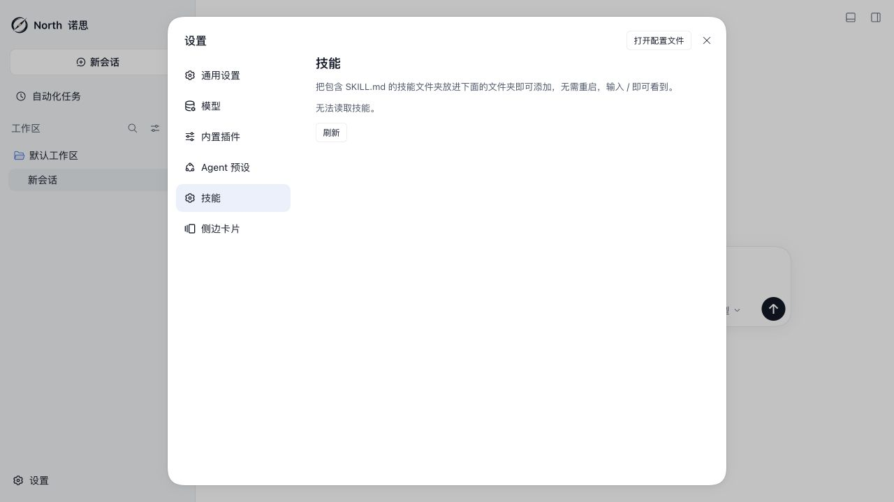
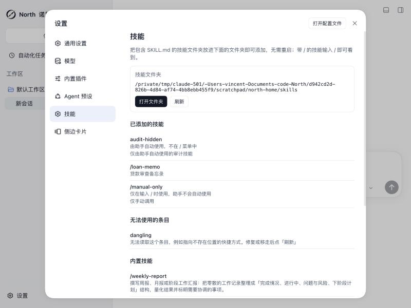
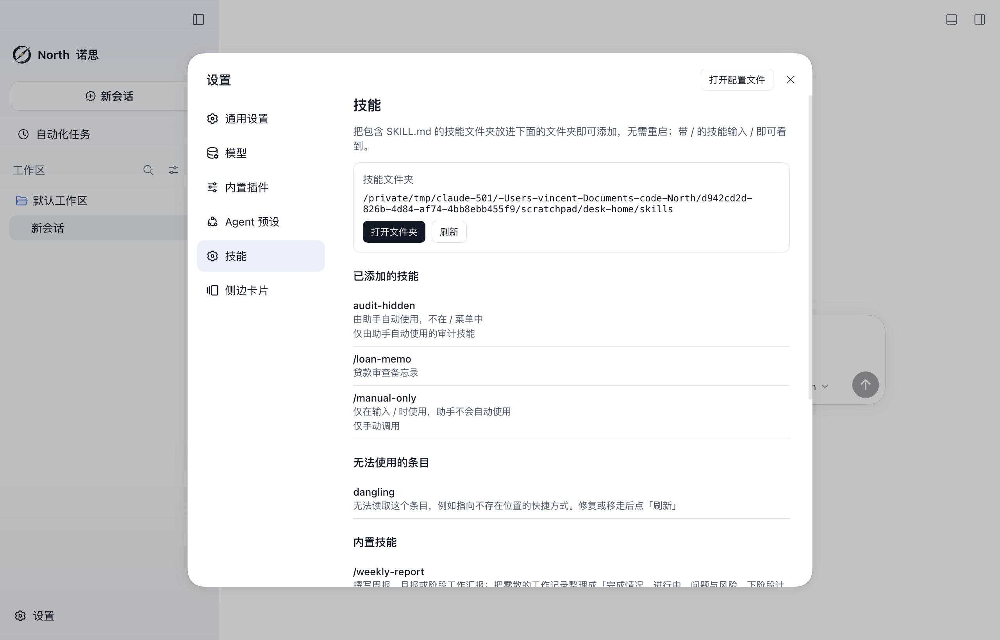
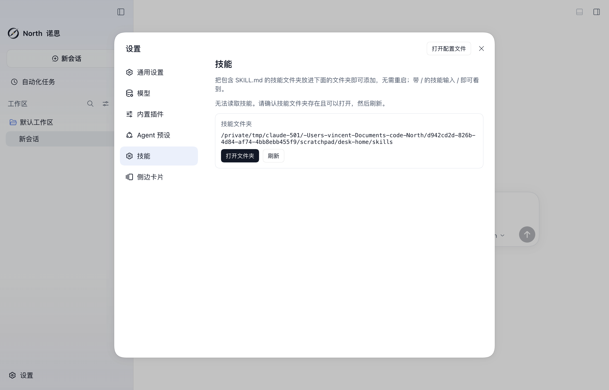
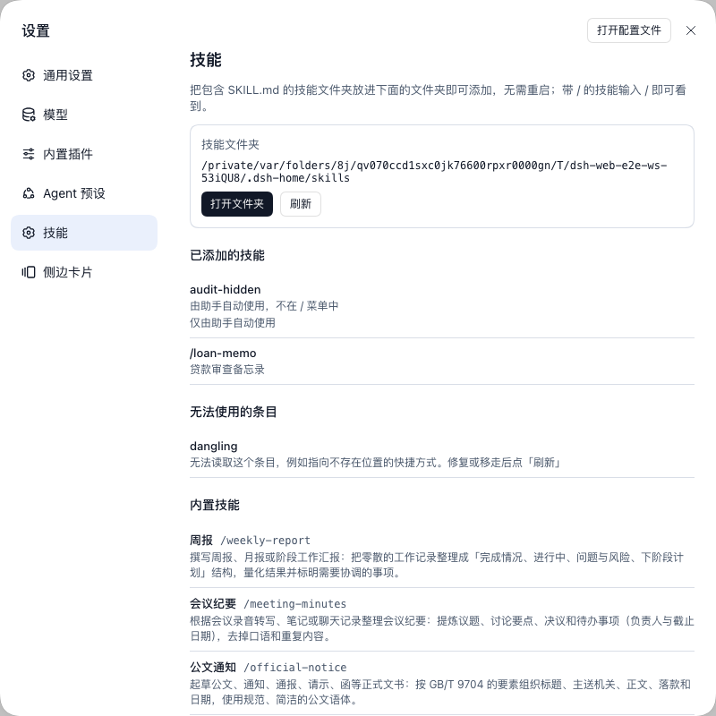
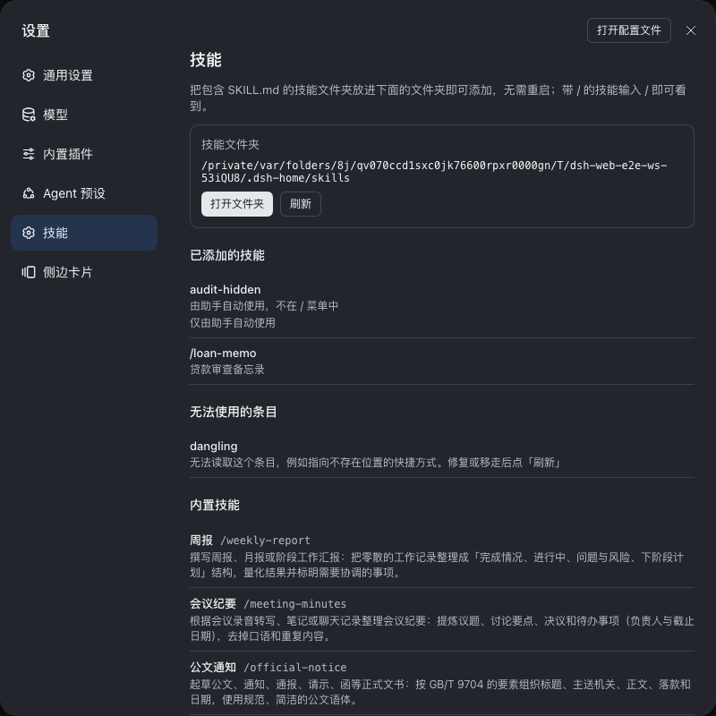

# North 代码、视觉与功能审计（2026-10-23）

审计日期：2026-10-23（北京时间）。本文是供 Claude 修复时使用的审计交接记录，记录当时工作区的观察结果，不代表修复完成或发布验收通过。审计时已有大量未提交改动，本轮未修改业务代码，也未提交、推送或发布。

## 结论与范围

发现两项 P2 功能问题：单个异常文件使技能页整体不可用；技能页把不允许用户调用的技能显示成斜杠命令。浅深色界面基础表现正常，但 Windows、真实模型和 Office 文件生成尚未验收。

重点检查 North 定制包、技能目录管理、发行版配置、主题与发送按钮，以及相关测试和桌面启动环境逻辑；没有穷尽上游框架全部代码。动态检查使用 macOS 上的隔离 Web 实例和临时技能目录，没有发送真实模型请求，也没有修改用户的实际技能库。

## F1：异常条目导致技能页整体不可用

**严重程度：P2。状态：已在完整 North Web 组合中复现，待修复。**

代码位置：[folder.ts](packages/north/skill-writing/src/folder.ts) 的 `readEntry()`、`readNorthSkills()`（审计时第 55、85 行），以及 [SkillsSection.tsx](packages/north/skill-writing/src/client/SkillsSection.tsx) 的失败分支（第 80–95 行）。

复现步骤：

1. 启动隔离的 North Web 组合，让 `DSH_HOME` 指向临时目录；不要使用真实用户目录。
2. 打开“设置 → 技能”，确认六项内置技能、技能目录路径和“打开文件夹”正常显示。
3. 在该临时技能目录中加入一个指向不存在目标的符号链接。
4. 刷新技能页，或关闭设置后重新进入技能页。

实际结果：整个页面只显示“无法读取技能”和“刷新”；正常技能、内置技能、目录路径和“打开文件夹”入口全部消失。删除或修复异常条目前，重复刷新无法帮助用户恢复。这里只在 macOS 上复现了符号链接场景，未声称已在 Windows 上复现。

根因：`stat(path)` 的拒绝没有在条目级处理；`Promise.all` 将单个条目异常传播成整个目录请求失败。客户端只保留 `loading / failed / ready` 状态，失败后不保留之前成功读取的数据。现有 `route.spec.ts` 还明确把某些不可读条目断言为 HTTP 500，未覆盖局部失败时正常内容仍可使用的行为。

建议修复：将条目级失败归入可定位的异常条目，保留正常条目和内置技能；目录整体不可读时提供明确的恢复提示。刷新失败时尽可能保留已有内容、目录路径和打开目录入口，不把未知条目误报为正常或空目录。

验收标准：

- 正常技能与失效符号链接并存时，正常技能仍显示，异常条目能被定位。
- 首次读取失败和刷新失败分别有测试；刷新失败不清空已显示的有效内容。
- 根目录整体不可读与单条目不可读采用不同处理，错误不被静默吞掉。
- 修复或移走异常条目后，刷新即可恢复，不要求重启应用。



## F2：技能展示与用户调用权限不一致

**严重程度：P2。状态：已核对测试技能的设置页展示和实际调用目录过滤逻辑，待修复。**

代码位置：[folder.ts](packages/north/skill-writing/src/folder.ts) 的 `readSkillSummary()`（第 41–44 行）、[shared.ts](packages/north/skill-writing/src/shared.ts) 的 `NorthSkillSummary`、[SkillsSection.tsx](packages/north/skill-writing/src/client/SkillsSection.tsx) 的 `SkillList()`（第 34–40 行）。实际调用目录的对照位置为 [skill-catalog.ts](packages/api/session-controller/src/skill-catalog.ts) 第 78 行的 `filter(isUserInvocable)`。

复现输入：在隔离用户技能目录中添加带合法 `name`、`description`，并设置 `user-invocable: false` 的技能文件，然后刷新技能页。

实际结果：技能页仍把该条目显示成 `/audit-hidden`，上方统一说明“输入 / 即可看到”；实际斜杠技能目录会过滤禁止用户调用的技能。设置页将目录清单与可手动调用清单混为一谈，用户无法判断为什么添加成功却不能按页面提示调用。

根因：服务端虽然复用了 frontmatter 解析器，却在摘要中丢弃了 `invocation`，客户端再无条件为每个技能名称添加 `/` 前缀。

建议修复：保留必要调用属性，并区分可手动调用、仅模型调用等状态；不可手动调用的条目不应表现为可执行斜杠命令。同步调整说明文案和共享响应类型，不必扩大为技能编辑器。

验收标准：

- 默认技能仍能按正常方式展示和调用。
- `user-invocable: false` 的技能不被展示为可手动调用命令。
- 只允许用户调用、只允许模型调用和两者均关闭的配置有清晰且准确的展示。
- 设置页与真实 `skills/list` 的权限语义一致，相关 UI 文案继续通过国际化检查。

## 视觉与功能设计观察

查看了浅色首屏、深色设置、800px 窄窗口，以及完整 North 组合的技能页；在这些已查看场景中，没有发现明显乱码、遮挡或主体溢出。主题测试也检查了浅深色 token 和发送按钮的默认、悬停状态，这不等于所有控件都完成了可访问性验收。

技能页的英文命令名和长描述占据主要信息层级。面向普通办公用户，可以优先展示“周报、会议纪要”等中文名称，英文调用名作为辅助信息。这是设计建议，不是已证实的功能缺陷；不要在修复 F1/F2 时顺带扩大改版范围。

现有 [north-theme.overlay.yml](apps/web/tests/north-theme.overlay.yml) 只挂载品牌插件，没有加载完整 North 配置、技能页及第三方侧栏。因此主题测试通过不能替代发行版整体回归。本次另行启动了完整 North Web 配置，确认办公助手默认项、技能设置入口及插件主导航隐藏，但未覆盖第三方侧栏所有交互。

## 已执行验证

以下结果来自本次审计，不应在代码修改后直接沿用为修复通过证据。

| 检查 | 结果 |
|---|---|
| `pnpm exec vitest run packages/north packages/skill/skill-filesystem/tests/skill-filesystem.spec.ts` | 8 个文件、63 项测试通过 |
| `DSH_SNAPSHOT=replay NORTH_THEME_REVIEW_DIR=/tmp/north-audit-20261023 pnpm exec vitest run --config vitest.web.config.ts apps/web/tests/north-theme.e2e.ts` | 1 项浏览器测试通过；检查了输出截图 |
| `pnpm run verify-client-ui-i18n` | 通过，检查 1069 个 Client UI 源文件 |
| `git diff --check`、`git diff --cached --check` | 通过 |
| 完整 North Web 组合人工检查 | 首次启动说明、默认办公助手、技能页和异常复现完成；未发送模型请求 |

完整组合的审计启动使用下列命令；这是 Web 检查，不包含 Desktop 专有 Office 运行时。复现时应改用新的临时目录，避免复用之前的测试状态。

```sh
DSH_HOME=/tmp/north-audit-home-20261023 \
DSH_AGENTS_HOME=/tmp/north-audit-agents-20261023 \
DSH_TELEMETRY_DISABLED=1 NORTH_LLM_API_KEY=EMPTY \
pnpm dsh web \
  --patch packages/north/bundle/cordis.patch.yml \
  --patch packages/north/bundle/presets/office.patch.yml \
  --patch apps/web/tests/pin-browse-picker.overlay.yml \
  --no-open --port 0
```

`EMPTY` 是隔离启动占位值，不是真实凭据。审计临时服务和浏览器已关闭；截图已复制到项目内，本文不依赖临时目录中的图片。

## 修复与后续验证边界

优先修复 F1、F2，并加入能在修复前失败、修复后通过的行为测试；不要仅修改现有断言来接受故障。按仓库要求验证共享类型、相关 README、国际化和构建，完成后分别记录每项问题的修复内容与实际执行结果。

以下项目尚未验证：Windows 安装及 100%/125%/150% 缩放、Electron 更新流程、真实内网模型交互、Word/Excel/PPT 生成、PDF 导出、全部网络连接行为，以及完整发行版端到端回归。本次没有重新构建，因此运行界面的现有构建产物与全部最新源码的一致性也未获得完整验证。不能据此声明生产可用、网络完全封闭或发布验收通过。

## 修复结果（2026-10-23 追加）

本节由修复会话追加，上文原始发现保持不变。两项结论经独立核实成立：修复前新增的行为测试中，失效符号链接使 `GET /north-skills` 返回 500，`user-invocable: false` 的技能摘要缺少调用属性且客户端无条件加 `/`。改动未提交、未推送、未发布，也未安装依赖。

### F1 修复方式

- [folder.ts](packages/north/skill-writing/src/folder.ts)：`readEntry()` 把单个条目的 `stat` / `readFile` 失败归为该条目的 `unreadable`，其余条目和内置技能照常返回 200；内置技能或用户文件夹本身无法读取时仍返回 500，并通过 `ctx.logger.warn` 记录原因。
- [shared.ts](packages/north/skill-writing/src/shared.ts)：`NorthSkillProblem` 增加 `unreadable`。
- [SkillsSection.tsx](packages/north/skill-writing/src/client/SkillsSection.tsx)：新增 `stale` 状态，刷新失败时保留上次成功结果、目录路径、「打开文件夹」和「刷新」，并显示刷新失败提示；首次读取失败显示带恢复步骤的提示和「刷新」。条目修复或移走后，刷新即可恢复。

### F2 修复方式

- `NorthSkillSummary` 增加 `invocation: { modelInvocable, userInvocable }`，取自提供者 `parseSkillFrontmatter` 的同一解析结果。
- 技能列表只为 `userInvocable` 的技能显示 `/<name>`，与会话 `skills/list` 的 `filter(isUserInvocable)` 一致；仅模型调用、仅用户调用、两者均关闭分别显示说明，默认技能不加标签。页首说明改为「带 / 的技能输入 / 即可看到」。
- 同步更新 [locales.ts](packages/north/skill-writing/src/client/locales.ts)（中英文案）、[SkillsSection.module.css](packages/north/skill-writing/src/client/SkillsSection.module.css)（说明行样式）、[README.md](packages/north/skill-writing/README.md)、[README.zh.md](packages/north/skill-writing/README.zh.md) 和 `README.i18n.yaml`（仅「Skills settings section」一节哈希变化）。

### 测试变更

- [route.spec.ts](packages/north/skill-writing/tests/route.spec.ts)：新增失效符号链接与正常技能并存、移走后刷新恢复的用例；新增三种调用策略的用例；原「不可读条目返回 500」用例改为条目级 `unreadable`（旧断言描述的正是 F1 故障行为）；根路径被文件占用仍断言 500。
- [section.client.spec.tsx](packages/north/skill-writing/tests/section.client.spec.tsx)：新增调用策略展示用例；刷新失败用例改为断言保留目录、技能和「打开文件夹」；首次失败用例断言恢复提示文案。
- 修复前运行：7 项失败（F1 返回 500、F2 缺少 `invocation`、刷新失败清空内容等），修复后全部通过。

### 实际验证证据

| 检查 | 结果 |
|---|---|
| `pnpm exec vitest run packages/north/skill-writing` | 5 个文件、24 项通过 |
| 同上加 `--coverage`（范围 `packages/north/skill-writing/src/**`） | 语句、分支、函数、行均 100% |
| `pnpm exec vitest run packages/north packages/skill/skill-filesystem/tests/skill-filesystem.spec.ts` | 8 个文件、65 项通过 |
| `pnpm run typecheck` | 5 个 gate 通过 |
| `scripts/run-oxlint.ts packages/north/skill-writing` | 通过 |
| `pnpm run verify-client-ui-i18n` | 通过，1069 个 Client UI 源文件 |
| `pnpm run verify-translation-pairing packages/north/skill-writing/README.md` | 通过 |
| `pnpm run verify-export-jsdoc`、`pnpm run verify-doc-budgets` | 通过 |
| `pnpm run build`（`build:artifacts` + `build:check`） | 9 个 gate 通过 |
| `git diff --check`（本次涉及路径） | 通过 |

完整 North Web 组合（`cordis.patch.yml` + `presets/office.patch.yml` + `pin-browse-picker.overlay.yml`，隔离的 `DSH_HOME` / `DSH_AGENTS_HOME`，`NORTH_LLM_API_KEY=EMPTY`，未发送模型请求）人工核验：

1. 技能目录放入正常技能 `loan-memo`、`user-invocable: false` 的 `audit-hidden`、`disable-model-invocation: true` 的 `manual-only`，以及失效符号链接 `dangling`。「设置 → 技能」返回 200，显示目录路径、「打开文件夹」「刷新」、三个用户技能、六个内置技能；`dangling` 列在「无法使用的条目」并说明原因；`audit-hidden` 无 `/` 前缀并标注「由助手自动使用，不在 / 菜单中」。
2. 将技能目录权限改为 000 后点「刷新」：请求返回 500，页面保留上次结果、路径和操作按钮，显示「刷新失败，下面是上次成功读取的结果。」
3. 恢复权限并删除 `dangling` 后点「刷新」：提示消失，异常条目消失，无需重启。
4. 输入框键入 `/`：技能组含 `manual-only` 和 `loan-memo`，不含 `audit-hidden`，与设置页展示一致。



### 仍未验证

- Windows 上的符号链接或权限异常、安装与缩放；Electron Desktop 中的技能页；真实内网模型交互；Word/Excel/PPT 生成与 PDF 导出；完整发行版端到端回归。
- 完整 `pnpm run doc-sync`、`pnpm run test:coverage` 全量门槛与 CI 平台矩阵未在本地运行；本次只运行上表列出的检查。
- 未新增录制会话快照：本次改动位于设置页，不经过会话事件流。
- 根目录整体失败时 `ctx.logger.warn` 的输出：Web 组合默认未显示 Host 日志，未观察到实际日志落点。
- 首次读取即整体失败时，接口不返回目录路径，页面只显示恢复提示和「刷新」，无法显示路径或「打开文件夹」。

## 剩余项处理（2026-10-23 第二轮追加）

本节补齐上一节「仍未验证」中可在本机完成的部分；上一节内容保留为当时的记录，以本节为准。

### 代码补充

- **首次读取失败也能看到目录**：路由的 500 响应体增加 `directory`（共享类型 `NorthSkillsFailure`）。客户端新增 `NorthSkillsLoadError`，在线路边界校验该字段；技能页首次读取失败时，若有路径则显示路径、「打开文件夹」和「刷新」。代理错误页、非 JSON 或字段类型不对时退回只显示「刷新」。
- **失效链接判定收窄**：条目 `stat` 失败时类型未知。扩展名为空或为 `.md` 的条目报 `unreadable`；其他扩展名（如 `notes.txt`）跳过，因为提供者不会把这类文件读成技能。`readFile` 失败（例如 `SKILL.md` 是目录）仍报 `unreadable`。
- **日志落点**：路由失败时调用 `ctx.logger.warn`，单测已用 logger exporter 捕获该告警，并做了负向对照（去掉调用后测试失败）。但 Web 和 Desktop 组合只在启动阶段收集 warn/error（`packages/boot/app-boot/src/index.ts` 的 diagnostics exporter），启动后没有任何 exporter，所以运行期这条告警不会落到任何地方。`skill-filesystem` 等插件的运行期告警同样如此，属于仓库层面的现状，本次未改。
- 同步了 README 中英文和配对哈希；按 `doc-sync` 要求重新生成了 `docs/config-catalog*.md` 和 `cordis-client-runner` 的 `slot-catalog.ts`。这两份目录过期，源于工作区已有的技能设置页改动。

### 检查与回归结果

| 检查 | 结果 |
|---|---|
| 本包测试 + 覆盖率 | 26 项通过，`packages/north/skill-writing/src/**` 四项指标 100% |
| North 相关测试 | 8 个文件、67 项通过 |
| `tsx scripts/run-oxlint.ts`（全部 42 个改动或新增的脚本文件） | 通过 |
| `pnpm run build` | 9 个 gate 通过 |
| `verify-client-ui-i18n`、`verify-translation-pairing`、`verify-export-jsdoc` | 通过 |
| `pnpm run doc-sync` | 43 项中 40 项通过；补生成后，`verify-client-catalog` 和 `verify-config-catalog` 也通过；`verify-repository-references` 仍因已提交历史中的 `python/sdk/uv.lock:113` 提交哈希引用而失败，与本次无关，未改 |
| `pnpm run test:coverage`（全量） | 2139 个文件中 17 个失败（23 项），均不在 North 或技能包内；关闭沙箱单独重跑仍失败，且失败集合会漂移，主要是 hooks、ptc-runtime-python、login-shell 等子进程用例 5 秒超时，以及 `gen-third-party-notices` 等生成物检查 |
| `pnpm run test:web:built`（Web 端到端，录制回放） | 196 个文件中 10 个失败，均不涉及技能页，归因见下 |
| `pnpm run test:e2e`（真实 DeepSeek API） | 首轮 110 个文件中 22 个失败，几乎都是 Messages 请求 404，原因是本机 shell 设置了 `DEEPSEEK_BASE_URL=https://api.deepseek.com/v1`；去掉该变量后重跑这 22 个文件，21 个通过，仅 `apps/desktop/tests/welcome-flow.e2e.ts`（保存 API key 返回 `ok: false`）失败 |

Web 端到端失败归因：

- **本机环境（已确认）**：在去掉密钥类环境变量的干净环境中重跑，`models-settings`、`onboarding-usable-provider` 均通过。`plugin-config` 仍显示「已配置密钥」，推断来自本机凭据，未进一步核实。`session-replay` 的 WebKit 用例因本机未安装 Playwright WebKit 而失败。
- **North 改名后测试预期未更新**：`pwa-manifest` 两项（名称期望仍为 "DeepSeek Harness"、图标颜色）、`built-boot`（查找 "DSH Local Build"）。
- **待判断**：`chat-scroll-contract`、`user-text-secret-mask`（亚像素几何偏差）、`preview-boot`（`HMR transactions cannot be nested`）。干净环境中重跑仍失败。

### Desktop、真实模型、Office 与侧栏

在 macOS 上用 `pnpm run dev:desktop` 启动，`DSH_HOME` 与 `DSH_DESKTOP_USER_DATA_DIR` 指向临时目录，模型为 DeepSeek 官方 API（`deepseek-flash`，key 来自项目 `.env`，未回显）；通过渲染进程调试端口用 CDP 读取页面：

1. 「设置 → 技能」与 Web 组合表现一致：`audit-hidden` 无 `/` 并带说明，`manual-only` 带说明，`dangling` 列为无法读取，`notes.txt` 被跳过。
2. 技能目录改为不可读后重新进入技能页：显示恢复提示、路径、「打开文件夹」和「刷新」；恢复权限并移走 `dangling` 后点「刷新」即恢复。
3. `/` 菜单含 `manual-only`、不含 `audit-hidden`，与设置页一致。本次未隔离 `DSH_AGENTS_HOME`，菜单中也列出了本机 `~/.agents/skills` 的技能（只读）。
4. 真实模型生成了 `周报.docx`（先发起一次澄清，选推荐项后生成），随后按要求生成 `周报.pdf`（1 页）、`任务清单.xlsx`（三行事项、状态、日期序列值）和 `汇报.pptx`（1 页）。用 `unzip` 核对内容、用 Quick Look 渲染查看，未见乱码、溢出或遮挡。模型补写的两处推断在回复中标为待确认。
5. 网络：在一轮请求期间，以 0.3 秒间隔对 Host 进程做 `lsof` 采样，唯一指向非本机服务的连接是本地代理 `127.0.0.1:7897`（继承自本机 `HTTPS_PROXY`），其余均为渲染进程与 Host 之间的回环连接。代理隐藏了真实目标主机，因此只能证明请求期间经代理外连，不能逐一列出目标域名。
6. 侧栏（Web 组合）：「文件 / Git / 任务管理 / 侧边对话(beta)」四个标签都能打开，终端标签按配置隐藏，「文件」中能在编辑器打开文件；控制台无错误。为避免改动工作区里已有的 Git 仓库，没有执行暂存、提交等 Git 写操作。






### 副作用

Desktop 的默认工作区固定为 `~/Documents/deepseek-harness/default-workspace/`，不受 `DSH_HOME` 隔离。模型在该目录新建了 `周报.docx`、`周报.pdf`、`任务清单.xlsx`、`汇报.pptx`、`weekly_docx.py`、`make_task_list.py`、`make_deck.py`；目录中原有的 `DSH-better-sidebar` 未被改动。经确认，这 7 个文件已于 2026-10-23 删除，目录中只剩 `DSH-better-sidebar`。

### 仍未验证

- Windows 安装、100%/125%/150% 缩放，以及 Windows 上的符号链接与权限行为：本机没有 Windows 环境。
- CI 平台矩阵：本次只提交不推送，CI 未运行。
- Electron 更新流程；真实内网 vLLM 网关（本次用 DeepSeek 官方 API 代替）；不经代理时的目标域名清单。
- Web 端到端中「待判断」的三项，以及 `welcome-flow` 失败的根因，未深入排查。
- 设置页改动未新增录制会话快照（不经过会话事件流）；升级指南未写（判断技能摘要字段变化仅本包内部使用）。

## 设计建议与发行版回归（2026-10-23 第三轮追加）

本节处理上文「视觉与功能设计观察」中的两项建议。

### 技能页优先显示中文名称

- 技能文件没有中文名字段，本次不新增 frontmatter 约定。内置 6 个技能的显示名放进本包的 locale 字典（`BUNDLED_TITLE`，中英各一份），符合「客户端文案归 locale 所有」的规则：周报、会议纪要、公文通知、邮件起草、翻译、长文总结。
- 内置技能每行先显示中文名，调用名以等宽次要文字跟在旁边。用户技能没有名称来源，仍以调用名开头；即使用户技能与内置技能同名，也不借用内置的中文名。
- 描述最多显示两行（完整文本仍在 DOM 中供读屏使用，悬停可看全文），长串路径可以断行。
- 技能页根元素改为带名称的 `<section>`（ARIA region「技能」），便于定位和读屏导航。
- `SKILL_NAMES` 移到 `shared.ts`，供 Host 和浏览器两侧共用；`index.ts` 仍从原位置导出。

### 完整 North 组合的回归测试

新增 `apps/web/tests/north-distribution.e2e.ts`：把 `packages/north/bundle` 作为已启用的 profile bundle 装载，与发行版的装载方式一致，不再像主题测试那样只挂品牌插件。测试内容：

- 页面标题为「诺思」；
- 连接工作区后打开右侧栏，预装侧栏的「文件 / Git / 任务管理 / 侧边对话(beta)」四个标签都存在；
- 技能设置页的 ARIA 快照（`apps/web/tests/expected/north-distribution/skills.expected.md`）：用户技能、`user-invocable: false` 技能、失效链接，以及带中文名的 6 个内置技能；
- 页面无脚本错误。

负向对照：把快照中的「周报」临时改成「周报X」后，测试失败；还原后通过。replay 模式连续运行两次均通过，原有 `north-theme.e2e.ts` 也仍然通过。

插件管理器和终端「数量为 0」的界面断言没有加入：在不含 North 的对照组合里，没能证明这两个入口会出现，这样的断言可能空转。它们在配置层面的禁用已由 `packages/north/bundle/tests/composition.spec.ts` 覆盖。

### 检查结果

| 检查 | 结果 |
|---|---|
| 本包测试 + 覆盖率 | 28 项通过，四项指标 100% |
| North 相关测试 | 8 个文件、69 项通过 |
| `north-distribution.e2e.ts`、`north-theme.e2e.ts`（replay） | 通过 |
| `pnpm run build` | 9 个 gate 通过 |
| oxlint（改动文件） | 通过 |
| `pnpm run doc-sync` | 43 项中 42 项通过；唯一失败是已知、与本次无关的 `python/sdk/uv.lock` 提交哈希引用；`docs/config-catalog*.md` 因 `index.ts` 行号变化已重新生成 |
| `verify-client-ui-i18n`、`verify-export-jsdoc`、`verify-translation-pairing` | 通过 |





800px 窄窗口截图也已检查，无溢出或遮挡。本轮未在 Desktop 中复核新版式，Windows 仍未验证。
